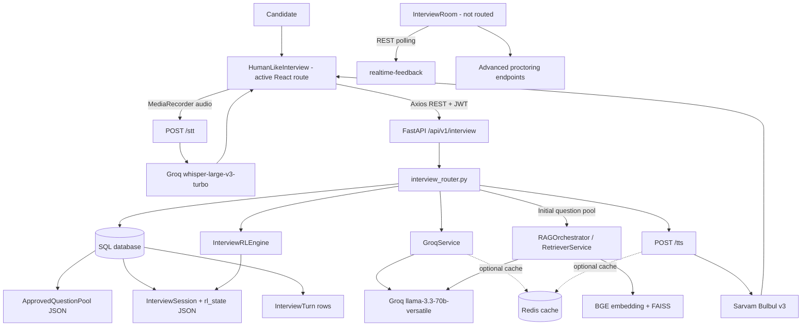

# EDI5 Interview Current State and New Architecture

**Scope:** Read-only implementation audit and proposed design.
**Code changes:** None.
**Evidence rule:** “Current” statements below describe inspected repository code, not documentation or roadmap language. Items not wired into the active flow are explicitly marked **NOT IMPLEMENTED**.

## 1. Executive Summary

### CURRENT — IMPLEMENTED

The active interview is a resume-seeded, question-pool interview:

1. The candidate selects the interview practice flow.
2. The candidate uploads a resume or uses a stored profile resume.
3. Resume parsing extracts profile fields; Groq creates a question pool which is stored in `ApprovedQuestionPool`.
4. An interview session is started from an approved pool.
5. The first question is selected from that pool and rephrased by Groq.
6. The browser records an answer, uploads the audio for speech-to-text, and submits the transcript to the answer endpoint.
7. The answer endpoint classifies and scores the answer, makes a deterministic follow-up/advance/completion decision, stores an `InterviewTurn`, updates `InterviewSession.rl_state`, and returns the action. For a normal `NEXT`, the next question is returned inline.
8. The report endpoint aggregates persisted turns after completion.

The active transport is authenticated Axios/HTTP REST. The candidate-facing route is `HumanLikeInterview`; a second page, `InterviewRoom`, is present but is not the route used by `App.jsx`.

### CURRENT — PARTIAL

- Resume skills and projects personalize the initial pool. Technical pool generation also uses knowledge-base retrieval. Per-answer classification does not receive the resume or prior conversation.
- A small Q-learning implementation influences selected question difficulty. Follow-up decisions themselves are rule-based, with a follow-up cap.
- Speech uses separate upload-based STT and request/response TTS calls. The active route does not stream audio or model output.
- A “realtime feedback” API and advanced proctoring code exist, but are not integrated into the active `HumanLikeInterview` route.
- Portfolio and Mock Drive pages exist, but the inspected routes do not show an interview flow wired through the same interview engine.

### PROPOSED

The smallest safe improvement is to preserve the existing API, data model, pool generator, and report path while extracting the `/respond` decision logic into a small orchestrator. For low latency:

1. Keep the pre-generated question pool as the immediate source of questions.
2. Use one bounded answer-understanding step and a deterministic policy to select the next question from the pool.
3. Avoid waiting for a second LLM call to produce filler dialogue or rephrase a question on every answer.
4. Return the next question in the existing `/respond` response contract.
5. Keep detailed scoring, reporting, and future pool enrichment off the candidate-visible critical path.

Measured endpoint latency and model quality are **runtime-measurement-required**; repository code alone does not provide measurements.

## 2. Current Architecture

The current active path is:

```text
PracticeOverview
  → POST /practice/start
  → ResumeUpload
  → POST /interview/resume/upload
  → parse_resume → RAGOrchestrator.parse_resume
  → GroqService.generate_question_pool
  → ApprovedQuestionPool
  → POST /interview/session/start
  → HumanLikeInterview (reads interview_id from localStorage; intro TTS)
  → GET /interview/session/{id}/next
  → POST /interview/stt
  → POST /interview/session/{id}/respond
  → InterviewSession + InterviewTurn
  → inline response action/next question + TTS
  → GET /interview/session/{id}/report
  → InterviewReport
```

`/api/v1/interview` is mounted by `app/api/v1/router.py`. The relevant route/controller implementation is `app/modules/interview/routers/interview_router.py`; request/response schemas live under `app/modules/interview/schemas/`.

`App.jsx` routes `/interview` to `HumanLikeInterview` and `/interview/report/:interviewId` to `InterviewReport`. Practice interview selection starts an interview practice session and navigates through `ResumeUpload`; that page stores `interview_id` in localStorage. No equivalent interview-start route was found in the inspected Portfolio Builder or Mock Drive UI.

### Component status

| Component | Status | Evidence-backed responsibility |
|---|---|---|
| `HumanLikeInterview` | CURRENT — IMPLEMENTED / active | Browser UI, MediaRecorder capture, REST sequence, displaying and speaking questions/actions. |
| `InterviewRoom` | CURRENT — PARTIAL / not routed | Alternate interview UI with advanced proctoring and feedback polling; not the `App.jsx` interview route. |
| `interview_router.py` | CURRENT — IMPLEMENTED | Session start, initial/next selection, response scoring/decision, completion, status, report, STT/TTS, feedback, and interview proctoring endpoints. |
| `GroqService` | CURRENT — IMPLEMENTED | Question-pool generation, rephrasing, answer classification, interviewer wording, feedback summary, and Whisper transcription. |
| `InterviewRLEngine` | CURRENT — IMPLEMENTED | Small persisted Q-table used to select difficulty. |
| `RAGOrchestrator` and `RetrieverService` | CURRENT — PARTIAL | Resume parsing and technical question-pool retrieval; not used for every answer or next question. |
| `InterviewSession` / `InterviewTurn` | CURRENT — IMPLEMENTED | Persist interview lifecycle, turn content, scores, follow-up linkage, and adaptive state. |
| Redis | CURRENT — PARTIAL | Optional cache for question rephrasing and TTS; it is not the authoritative interview state store. |
| WebSocket/SSE | CURRENT — NOT IMPLEMENTED | No streaming interview transport was found in the active route/services. |

## 3. Current Backend Flow and API

All interview paths below are prefixed by `/api/v1`. The backend route names are shown relative to `/interview`.

| Method and path | Handler / purpose | Request and response contract | Main work and persistence |
|---|---|---|---|
| `POST /interview/resume/upload` | `upload_resume`: parse uploaded resume and create question pool | Multipart `file`; optional query `session_id`, `interview_type` (default technical). Returns `ResumeUploadResponse {status, pool_id, question_count, pending_approval, detected_role?}`. | Calls `parse_resume`, then `GroqService.generate_question_pool`; stores extracted profile/pool in `ApprovedQuestionPool`. |
| `POST /interview/resume/use-profile-resume/{resume_id}` | `use_profile_resume`: use stored resume | Path `resume_id`; same optional query fields/response as upload. | Reads stored parsed skills/projects, generates and stores a pool. |
| `GET /interview/admin/pools` | `list_pools_for_admin` | Optional query `status`; raw pool summary list. | Admin pool review. |
| `GET /interview/pool/{pool_id}` | `get_pool` | Path pool ID; `QuestionPoolResponse {pool_id, questions, approved, extracted_skills, detected_role?}`; each `QuestionItem` has question, difficulty, topic, phase. | Reads pool, question content, approval state, skills, and role. |
| `PUT /interview/pool/{pool_id}/approve` | `approve_pool` | `ApprovePoolRequest {approved: bool}`; `ApprovePoolResponse {status}`. | Updates approval state and approver/timestamp. |
| `POST /interview/session/start` | `start_interview` | Required query `pool_id`; returns `StartInterviewResponse {interview_id, phase, total_turns}`. | Creates an `InterviewSession` from an approved pool and associates the newest active interview `AssessmentRound` when available. |
| `GET /interview/session/{interview_id}/next` | `get_next_question` | Path interview ID; `NextQuestionResponse {turn_number, question, question_id, difficulty, phase}`. | Loads persisted pool/RL state, selects by phase/difficulty, optionally rephrases, stores current-question state. |
| `POST /interview/session/{interview_id}/respond` | `submit_response` | `SubmitResponseRequest {transcript, response_time_sec, behavioral_snapshot?}`; `SubmitResponseResponse {action, message, is_complete, followup_type?, next_question?, scores?, interview_summary?}`. | Classifies and scores answer, applies follow-up/advance/complete policy, persists turn and state, returns the decision and usually next question inline. |
| `POST /interview/session/{interview_id}/complete` | `complete_interview` | Path interview ID; untyped dictionary with status/reason/counts/performance/completion ratio. | Marks early completion and finalizes a linked eligible assessment round. |
| `GET /interview/session/{interview_id}/status` | `get_interview_status` | Path interview ID; untyped dictionary with interview/session/round IDs, status, phase, question counts, average score, timestamps. | Reads state and reports current lifecycle data. |
| `GET /interview/session/{interview_id}/report` | `get_report` | Path interview ID; `InterviewReportResponse` with aggregate scores, feedback summary, turn reviews, follow-ups, and completion data. | Aggregates stored main turns and their follow-ups for post-interview reporting. |
| `POST /interview/stt` | `speech_to_text` | Multipart `audio`; returns `{"transcript": ...}`. | Calls Groq Whisper transcription. |
| `POST /interview/tts?text=...` | `synthesize_speech` | Required `text` query (max 2500 chars); returns WAV bytes. | Calls Sarvam TTS and returns audio. |
| `POST /interview/realtime-feedback` | `realtime_feedback` | `RealtimeFeedbackRequest`; `RealtimeFeedbackResponse` | HTTP feedback request; not a streaming endpoint and not used by the active interview route. |
| `POST /interview/advanced-proctoring/analyze-frame` | `analyze_frame` | Multipart frame and required `session_id`; returns violation/phone summary. | Frame/phone detection and logging for the advanced proctoring flow. |
| `POST /interview/advanced-proctoring/log-event` | `log_event` | `LogEventRequest {session_id, event_type, confidence_score?, face_count?, metadata?}`. | Writes a proctoring event for interview flow. |

### Endpoint findings

- **Question endpoint:** `GET .../next` is used to load the initial question. The active UI does not issue it for every turn.
- **Answer endpoint:** `POST .../respond` is the interactive decision endpoint. On `NEXT`, the next question is carried in `data.next_question`; on `FOLLOWUP`, the follow-up text is carried in `data.message`.
- **Follow-up endpoint:** a separate follow-up route is **NOT IMPLEMENTED**. Follow-up handling is part of `/respond`.
- **Transcript endpoint:** a dedicated transcript-only endpoint is **NOT IMPLEMENTED**. The report endpoint returns report data; the active report UI displays turn questions and scores but does not render candidate answers in the inspected UI.
- **Evaluation endpoint:** a separate endpoint is **NOT IMPLEMENTED**. Evaluation runs inside `/respond`.
- **WebSocket/SSE/streaming:** **NOT IMPLEMENTED** for the active interview flow. `/realtime-feedback` is ordinary REST.
- The active UI retries STT once on HTTP 429; other STT failures may proceed with an empty transcript. The alternate `InterviewRoom` logs STT failure and also proceeds with an empty transcript.

## 4. Current Database and Data Model

### Implemented entities

| Model | Purpose and fields used by interview | Created/updated/read by |
|---|---|---|
| `AssessmentSession` | Candidate assessment container and owner. | Session service creates it; interview start reads it. |
| `AssessmentRound` | Interview round lifecycle, `round_type`, status, score, start/completion times, parent `session_id`. | Session service creates/activates it; interview completion updates it. |
| `InterviewSession` | Interview runtime record: `id`, `session_id`, optional `round_id`, `phase`, `current_turn`, `total_turns`, JSON `rl_state`, `status`, completion reason/time, creation time, personalization metadata. | Interview start creates; `/next` and `/respond` update; status/report read. |
| `ApprovedQuestionPool` | Candidate-scoped question pool and approval record; stores generated pool JSON, extracted skills/projects, role, approval metadata, and assessment `session_id`. | Resume upload/profile-resume generation creates it; approval endpoint updates it; question selection reads it. |
| `InterviewTurn` | Persisted question/answer/evaluation turn. Fields include `interview_id`, `turn_number`, `question_text`, `question_difficulty`, `candidate_response`, `response_time_sec`, `content_score`, `final_score`, `intent`, `behavioral_snapshot`, `rl_reward`, follow-up flag/number/parent linkage, and personalization/classification metadata. | `/respond` creates rows; report/status services aggregate them. |
| `User` / candidate profile and resume records | Identity and stored resume/profile data used by authentication and the profile-resume entry path. | Profile/resume modules manage these; `use-profile-resume` reads available parsed profile values. |
| Proctoring event models | Event evidence for proctoring paths. | Proctoring routes/services create and read records. |

### Not separate persistence entities

- A separate normalized `InterviewQuestion` table is **NOT IMPLEMENTED** for the generated pool/current questions; the question pool is stored as JSON and the selected question/current state is in `InterviewSession.rl_state`.
- A separate `InterviewAnswer` or `InterviewEvaluation` table is **NOT IMPLEMENTED**; answer and evaluation fields are stored together in `InterviewTurn`.
- A durable competency-profile update tied to each interview turn is **NOT IMPLEMENTED** in the active `/respond` flow.
- Redis is **NOT** the source of truth for session/turn state.

### Relationship diagram

```text
User
  ├── AssessmentSession
  │     ├── AssessmentRound (round_type = interview)
  │     │      └── InterviewSession (optional round_id link)
  │     ├── ApprovedQuestionPool
  │     └── InterviewSession (session_id)
  │            ├── InterviewTurn (interview_id)
  │            │      └── InterviewTurn follow-up
  │            │             (parent_turn_id)
  │            └── rl_state JSON
  └── Profile / Resume records
         └── parsed skills/projects supplied to pool generation
```

The `InterviewSession.round_id` link is nullable; older/unlinked interview records may therefore lack a direct interview-round association.

`start_interview` chooses the newest `AssessmentRound` for the pool's assessment `session_id` where `round_type == "interview"` and status is lowercase `"active"`; otherwise it stores `round_id = null`. Automatic completion marks the interview `COMPLETED` with reason `ALL_QUESTIONS_COMPLETED`, timestamp, and (if the linked round is exactly `"active"`) round completion timestamp and rounded average main-turn score. Explicit completion uses `USER_SUBMITTED` and finalizes a linked round unless already completed, terminated, or expired. Neither observed interview-completion path updates `AssessmentSession.status`.

## 5. Current Question Generation

### Initial pool creation — CURRENT — IMPLEMENTED

1. The upload route reads the resume file and calls `parse_resume`.
2. `resume_service.py` delegates PDF text extraction and LLM extraction to `RAGOrchestrator.parse_resume` (PyMuPDF for text; Groq for structured skills, projects, experience, education, and summary; keyword fallback when parsing fails).
3. `upload_resume` passes extracted skills/projects and interview type to `GroqService.generate_question_pool`.
4. The generator detects a role and, on the technical path, calls the retriever for up to five knowledge-base passages. The pool-generation Groq prompt receives skills, projects, role, interview type, and retrieved context for technical pools.
5. The generated pool is persisted in `ApprovedQuestionPool`.

The user-specific full resume text is not supplied to the active pool-generation call; the route passes extracted profile values. The separate `RAGOrchestrator.generate_questions` method is not the path called by this upload route. Its resume index creation is explicitly disabled.

### Per-turn selection and rephrasing — CURRENT — IMPLEMENTED

`GET /session/{id}/next` restores/selects difficulty with `InterviewRLEngine`, filters the stored pool by phase and difficulty, and calls `GroqService.rephrase_question` on a cache miss. It persists selected/current question state in `InterviewSession.rl_state`.

For later questions, `/respond` selects the next pool item itself and includes it in the response. It does not perform a new RAG search or full question-pool generation per answer.

More precisely, `/next` uses `last_score` and `turn` as input to difficulty selection. It filters to unasked questions, then phase, then difficulty; falls back to any phase match or unasked question, and reuses the first pool item if all are exhausted. It writes `current_question_text`, `current_question_difficulty`, `current_question_id`, and `asked_question_ids` to `rl_state` before rephrasing. Its completion guard checks `phase == "COMPLETE"` rather than interview `status`.

### Follow-up — CURRENT — PARTIAL

`/respond` reads the current question/difficulty from `rl_state`. A transcript shorter than five characters increments `silence_count` and returns `RETRY` once; a second short/empty response skips classification and forces `NEXT` with `SHORT`, `NEUTRAL`, and content score 0. For non-empty answers it calls `GroqService.classify_answer`.

The follow-up/action precedence is:

1. Second-silence path → `NEXT`.
2. `followup_count >= 2` → `NEXT`.
3. `NEGATIVE` intent → one follow-up if `negative_count == 0`, otherwise `NEXT`.
4. `IRRELEVANT` quality → one follow-up if `irrelevant_count == 0`, otherwise `NEXT`.
5. `SHORT` or `PARTIAL` quality → `FOLLOWUP`.
6. `GOOD` quality → `NEXT`.

`NEXT` becomes `COMPLETE` when `current_turn + 1 >= total_turns`; otherwise turn count advances and per-turn follow-up/negative/irrelevant/silence counters reset. The route preselects a next pool question for `NEXT`. It then calls `GroqService.generate_interviewer_response` with current question/answer, classifier fields, action/follow-up type, selected next-question text, and up to six recent conversation-history messages. This LLM call supplies wording, not the decision. Follow-ups are stored as turn records linked to the latest non-follow-up parent. A separate `ContextualFollowupGenerator` exists but is a stub and is **NOT IMPLEMENTED** in the active path.

## 6. Current Answer Evaluation

### Implemented request path

```text
MediaRecorder audio
  → POST /interview/stt
  → Groq Whisper transcript
  → POST /session/{id}/respond
  → GroqService.classify_answer
  → numeric score calculation + deterministic action
  → GroqService.generate_interviewer_response
  → InterviewTurn + InterviewSession.rl_state persistence
  → action and (for NEXT) next question returned inline
```

The classifier receives the current question, answer transcript, and interview type. It does not receive resume context, retrieved documents, prior conversation, or competency history. Classification is LLM-based with a code fallback for malformed/error output; the numeric content score is returned by Groq and clamped into `[0, 1]`. The prompt defines answer-quality labels such as `IRRELEVANT`, `SHORT`, `PARTIAL`, and `GOOD`.

### Implemented score components

- `intent_score`: `POSITIVE = 1.0`, `NEUTRAL = 0.6`, `NEGATIVE = 0.3`.
- `behavior_score`: `0.4 × eye_contact_pct + 0.3 × voice_score + 0.3 × head_stability`.
- Voice score uses response-time thresholds: `1.0` if response time is over 5 seconds, `0.5` if over 2 seconds, otherwise `0.0`.
- Final score: `0.5 × content_score + 0.3 × intent_score + 0.2 × behavior_score`.
- The active `HumanLikeInterview` sends a fixed behavioral snapshot (`eye_contact_pct: 0.5`, `head_stability: 0.7`), not live face/gaze measurements.

### CURRENT — NOT IMPLEMENTED

- A separately persisted confidence estimate or calibrated confidence interval is **NOT IMPLEMENTED** by the inspected live path.
- Competency profile mutation/history updates are **NOT IMPLEMENTED** as a consequence of answer evaluation.
- Runtime calibration/reliability metrics for the Groq classification score are **NOT IMPLEMENTED**.

## 7. Current Interview State Machine

```text
POOL_READY
  → INTERVIEW_STARTED
  → QUESTION_SELECTED / stored in rl_state
  → CANDIDATE_RECORDING (frontend state)
  → TRANSCRIPT_SUBMITTED
  → ANSWER_CLASSIFIED_AND_SCORED
  → FOLLOWUP | NEXT | COMPLETE | RETRY
  → QUESTION_SELECTED (for NEXT) / follow-up turn (for FOLLOWUP)
  → COMPLETED
```

| Concern | Current source of truth |
|---|---|
| Interview identity | Database `InterviewSession.id`, held by frontend/localStorage between pages. |
| Assessment identity | `InterviewSession.session_id`; active interview round is optionally associated using `round_id`. |
| Current question and RL state | `InterviewSession.rl_state` JSON plus frontend view state. |
| Turn/answer identity | `InterviewTurn.id`; answer, question, scores, response time, and follow-up linkage stored on the turn. |
| Phase/current-turn counters | `InterviewSession.phase`, `current_turn`, `total_turns`; frontend also keeps current question/action state. |
| Status and completion | `InterviewSession.status`, completion reason/time; linked `AssessmentRound` status/score/time is updated on completion. |
| Audio capture/transcription | Frontend MediaRecorder until upload, then server STT request. |
| Redis | Optional cache only; **NOT** authoritative interview state. |

State is mixed: the database stores durable interview and turn state; frontend component state controls recording/display; `rl_state` stores serialized current/adaptive state; Redis caches selected generated outputs. No durable Redis-backed conversation state machine was found.

Observed `rl_state` keys include `current_question_text`, `current_question_difficulty`, `current_question_id`, `asked_question_ids`, `last_score`, `turn`, `q_table`, `epsilon`, `conversation_history`, `silence_count`, `followup_count`, `negative_count`, and `irrelevant_count`; exact values evolve as the flow progresses. Turns are created on `/respond`, not when `/next` selects/displays a question.

Two state/reporting caveats: `/respond` increments `current_turn` only when advancing to a non-final turn, while status derives attempted-question count from `current_turn`; and phase transitions to `TECHNICAL` at turn five. Treat these counter semantics as behavior to preserve or deliberately migrate, not as a fully normalized state machine.

## 8. Current Latency Analysis

No source-code latency measurements, histograms, or endpoint traces were found. The values below are relative critical-path classification, **not measured milliseconds**. Actual per-stage and end-to-end timings are **runtime-measurement-required**.

| Operation | Local/remote | Sync/async in active flow | CPU/GPU / cost class | Expected latency from code | Parallelizable / streamable today? |
|---|---|---|---|---|---|
| Browser audio recording | Local | Browser async event callbacks | Device/browser | Candidate response duration; not an inference latency | No backend call until recording stops. |
| Audio upload + STT | Remote Groq | Synchronous HTTP request from UI | Remote model inference + network | **Runtime-measurement-required** | Not streamed; frontend waits for full transcript. |
| `/respond` answer classification | Remote Groq | Synchronous inside request | Remote model inference + network | **Runtime-measurement-required** | Must produce enough understanding before action; no streaming response. |
| Follow-up/interviewer wording | Remote Groq | Synchronous inside request after classification, including the second-silence forced-`NEXT` path | Second serial remote inference + network | **Runtime-measurement-required** | Could be removed from fast path or combined with classification; currently serial. |
| Next pool selection / DB writes | Local app/database | Synchronous | Application CPU + database I/O | **Runtime-measurement-required** | Separate local stages can be measured; no need to wait on another question endpoint. |
| Initial question rephrase | Remote Groq, Redis cache optional | Synchronous on cache miss | Remote model inference + network | **Runtime-measurement-required**; bypassed on cache hit | Cache can avoid call for matching question+difficulty; not streamed. |
| Technical pool RAG retrieval | Local embedding/FAISS plus data access | Synchronous during pool creation | Embedding inference on CPU/GPU depending on deployment + FAISS/IO | **Runtime-measurement-required** | Not repeated on every answer; query embedding/search happen per retrieval. |
| Resume parse + initial question-pool generation | Remote Groq plus local PDF parsing/retrieval | Synchronous before interview | PDF/text CPU + optional embedding inference + remote model/network | **Runtime-measurement-required** | Outside answer-to-next-question turn, but delays setup. |
| TTS | Remote Sarvam, Redis cache optional | Synchronous HTTP request then browser playback | Remote synthesis + network | **Runtime-measurement-required**; bypassed on cache hit | Not streamed; separate call after text is available. |
| Feedback summary/report | Remote/DB, post-interview | Post-interview route path | Remote model inference + DB aggregation | **Runtime-measurement-required** | Not required to display the next question. |

### Main latency diagnosis

The active interview already avoids a repeated `GET /next` round-trip after every answer. The expensive part is the serial answer path: audio upload/STT, then `/respond` classifier LLM call, then a second LLM interviewer-wording call before the response is returned. TTS adds another network call before speech playback completes.

The configured Groq chat model is `llama-3.3-70b-versatile`; question generation, rephrasing, answer classification, interviewer wording, and feedback summary use it. STT uses `whisper-large-v3-turbo`; TTS uses Sarvam `bulbul:v3`. Question rephrase and TTS have optional Redis caches with a 24-hour TTL; Redis absence/failure falls back to a provider call. Resume parse, question-pool generation, classifier, and interviewer wording have no corresponding cache in the inspected paths. The embedding model and FAISS index are initialized as process-level objects, but each retrieval embeds the query and searches.

Groq call sites do not configure explicit timeouts, retry/backoff, or a streaming response in the inspected code. Error fallbacks exist in service methods; active UI behavior may submit an empty transcript after some STT failures. Provider/SDK implicit timeout behavior and actual latency require runtime verification.

## 9. Current Personalization

| Candidate signal | Current status | Evidence |
|---|---|---|
| Resume | USED before the interview to extract fields; full raw text is not passed to the active classifier. | `resume_service.py`, `RAGOrchestrator.parse_resume`, upload route. |
| Skills | USED in generated question pool. | `GroqService.generate_question_pool`. |
| Projects | USED in generated question pool. | `GroqService.generate_question_pool`. |
| Experience/education/summary | Extracted by resume parsing; the upload route’s active pool call supplies skills/projects, not the separate RAG question-generation context. | `RAGOrchestrator.parse_resume`; separate `RAGOrchestrator.generate_questions` is not called by the upload route. |
| Knowledge-base context | USED for technical question-pool generation via retrieval; not included in answer classification. | `RetrieverService`, `GroqService.generate_question_pool`. |
| Prior questions/answers | PARTIALLY USED: up to six recent history entries are given to interviewer-wording generation; classifier receives only current question and answer. | `/respond`, `GroqService`. |
| Previous practice results | NOT IMPLEMENTED in active interview selection/evaluation context. | No active route/service integration found. |
| Previous interview results | NOT IMPLEMENTED as candidate context for the active interview loop. | No active route/service integration found. |
| Durable competency profile / weak or strong topics | NOT IMPLEMENTED in the active interview answer loop. | No turn-triggered competency update found. |
| Company / role requirements | PARTIALLY USED: role detection and interview type influence question-pool prompts. | Pool generation path. |
| Per-answer behavioral measures | PARTIALLY USED: server formula accepts snapshot, but active route submits fixed values. | `HumanLikeInterview` request payload. |

`PersonalizationService` and `ContextualFollowupGenerator` contain intended interfaces/descriptions but include stubs and are not invoked by the active route. Their described features are **NOT IMPLEMENTED** in the live interview path.

## 10. Current Adaptive Behavior

### Real adaptation — CURRENT — IMPLEMENTED

`InterviewRLEngine` uses a very small state key: a `last_score` bucket (`low`, `mid`, `high`) and a turn bucket. Its actions are `EASY`, `MEDIUM`, and `HARD`. It selects epsilon-greedily, then the router filters the pool by selected difficulty and phase with fallback selection when no exact match exists.

The router stores the Q-table and epsilon in `InterviewSession.rl_state`. Q-learning updates occur on `NEXT`/`COMPLETE` using the selected difficulty as the action. Reward starts from `final_score`, adjusts for irrelevant/negative answers and difficulty mismatch, adds a modest reward for midrange content scores, and is clamped to `[-1, 1]`.

### Rule-based conversational adaptation — CURRENT — IMPLEMENTED

The response decision is deterministic: classifier intent/quality, score/counters, silence/retry handling, and the follow-up cap choose among `FOLLOWUP`, `NEXT`, `COMPLETE`, or `RETRY`. The LLM interviewer wording is generated after this decision and does not make the decision itself.

The RL state key is `<score_bucket>_<turn_bucket>`: score is `low` below 0.4, `mid` from 0.4 through 0.7, `high` above 0.7; turn bucket is `min(turn // 3, 3)`. Actions are `EASY`, `MEDIUM`, `HARD`; epsilon-greedy selection uses alpha 0.1, gamma 0.9, epsilon initial 0.2, minimum 0.1, decay 0.995. Reward begins at `final_score`, subtracts 0.3 for `IRRELEVANT`, subtracts 0.2 for negative intent, penalizes mismatched difficulty (EASY with content >0.8: -0.2; HARD with content <0.3: -0.3), adds 0.1 for content in [0.4, 0.8], then clamps to [-1, 1]. Updates occur on `NEXT`/`COMPLETE`, not `FOLLOWUP`/`RETRY`.

### Limitations

- The Q-state omits topic mastery, uncertainty, answer evidence, response-time trend, and follow-up depth.
- The new session begins with an empty Q-table; unseen actions are randomized. Persisted Q-values may influence later difficulty selection, but actual improvement has not been measured.
- RL does not generate questions and does not personalize against a durable competency profile.
- Adaptive clarification and targeted probing based on missing answer evidence are not implemented as a distinct policy.

Q-learning exists in code; evidence that it improves interviews is **NOT IMPLEMENTED / runtime-measurement-required**.

## 11. Current Architecture Diagram



The active flow uses `HumanLikeInterview`; the final two connections are present in the alternate, unrouted `InterviewRoom` path.

## 12. Proposed Interview Architecture

Reuse current persistence, services, and contracts first. Extract a coherent orchestration layer rather than replacing FastAPI, Groq, the question pool, or report generation.

| Proposed component | Change type | Why / problem solved | Consumes | Produces |
|---|---|---|---|---|
| Interview Orchestrator | REFACTOR from `/respond` route logic into a small service | Centralizes answer → policy → select → persist flow and keeps HTTP concerns thin. | InterviewSession, current question, transcript, turn history, policy. | One atomic response decision and next question payload. |
| Conversation State | REUSE `InterviewSession.rl_state`, refine/version keys | Avoids a new state store/table initially; formalizes active question, topic, difficulty, follow-up depth, and used pool items. | Session state + persisted turns. | Versioned, resumable turn state. |
| Candidate Context | REUSE `ApprovedQuestionPool` and resume parser; add only missing fields if evidence requires | Provides stable candidate facts without reparsing resume on each turn. | Extracted skills/projects/role and pool. | Bounded context object for planner/generator. |
| Competency State | PROPOSED lightweight per-session scores/uncertainty; do not claim current profile integration | Makes adaptive behavior evidence-driven rather than relying on one score bucket. | Turn score/evidence, topic, prior state. | Topic-level estimate and uncertainty. Persist in state first; normalize later if needed. |
| Answer Understanding | REFACTOR `GroqService.classify_answer` contract | Replace loose parse/fallback output with validated structured fields; one bounded call rather than separate classifier and wording calls. | Transcript, current question, interview type, compact recent turns. | Quality, intent, evidence/missing points, uncertainty. |
| Follow-up Decision Engine | EXTRACT current deterministic branching; extend with explicit actions | Makes policy testable and independently tunable from LLM wording. | Structured understanding, topic state, turn budget, follow-up depth. | `FOLLOW_UP`, `CLARIFICATION`, `DEEPER_PROBE`, `NEW_TOPIC`, `DIFFICULTY_UP`, `DIFFICULTY_DOWN`, `MOVE_ON`, or `COMPLETE`. |
| Question Planner | REUSE pool filtering + RL difficulty selection, add topic/used-question constraints | Selects a suitable pre-generated question without waiting for generation every turn. | Policy action, pool, phase, topic coverage, used IDs, time budget. | A question plan and selected pool item. |
| Question Generator | REUSE `GroqService.generate_question_pool` for setup/replenishment; optionally generate targeted follow-ups off critical path | Preserves existing prompts and role-specific generation while avoiding serial model calls on every answer. | Candidate context, competency gaps, question plan. | Validated question(s) appended to pool. |
| Slow-path evaluator | PROPOSED only if detailed evaluation becomes too expensive for live decisions | Keeps full analytics/report enrichment from delaying the next question. | Persisted transcript/turn and context. | Detailed feedback/competency/report fields. |

### Major decision: reuse first

- Keep `InterviewSession`, `InterviewTurn`, `ApprovedQuestionPool`, `GroqService`, and `InterviewRLEngine`.
- Extract/refactor the active `/respond` logic before adding new persistence or queue infrastructure.
- Do not deploy Redis as the authoritative state store; current database state is already durable.
- Do not add a message broker until measured throughput/latency or reliability needs justify it.

## 13. Proposed Human-Like Interview Loop

```text
QUESTION
  → ANSWER TRANSCRIPT
  → FAST ANSWER UNDERSTANDING
  → UPDATE TOPIC STATE
  → POLICY DECISION
  → SELECT PRE-GENERATED QUESTION / FOLLOW-UP TEMPLATE
  → PERSIST TURN + NEXT STATE
  → RETURN QUESTION INLINE
```

Suggested deterministic policy ordering:

1. **RETRY:** transcript is empty/unusable or STT reports a recoverable failure; do not score an empty answer as poor competency.
2. **CLARIFICATION:** answer appears relevant but is ambiguous or lacks the specific evidence required by the question.
3. **FOLLOW_UP / DEEPER_PROBE:** answer contains a useful claim but lacks rationale, trade-off, result, or technical detail; cap probes per parent question.
4. **DIFFICULTY_DOWN:** repeated weak/uncertain answers suggest the current level prevents useful evidence collection.
5. **DIFFICULTY_UP:** strong evidence at current level supports a more challenging question.
6. **NEW_TOPIC:** current topic has enough evidence or needs coverage balancing.
7. **MOVE_ON / COMPLETE:** follow-up/time/turn budget reached, or required competencies have adequate evidence.

The policy should use labeled thresholds initially and log its input/output for later tuning. The first version should not use an unvalidated generative LLM decision as the sole controller.

## 14. Fast Path vs Slow Path

### Proposed fast path — candidate-visible

```text
Transcript (prefer client-finalized STT initially)
  → one bounded structured understanding call OR conservative local fallback
  → update compact session state
  → deterministic policy
  → select from already generated pool
  → persist current turn/state
  → return next question inline
```

Keep to one interactive request after transcript availability. Do not wait for a second Groq call to write conversational filler. Text should be rendered immediately; TTS may start independently and remain non-blocking.

### Proposed slow path — not on the candidate-visible critical path

- Detailed rubric feedback beyond the fields needed for immediate action.
- Recomputing durable competency profiles or analytics.
- RAG enrichment and generation of future questions.
- Report narrative/summary generation.
- Long-term policy evaluation and training data aggregation.

Initially, the slow path can be omitted or performed after the interaction; adding a background queue/worker is a separate architecture decision. Do not create an unmonitored in-process fire-and-forget job for important persisted results.

### Candidate answer/audio UX

The safest first latency step is not a speech architecture rewrite: keep the existing audio upload and STT contract, instrument it, and remove avoidable serial model calls after STT. A later streaming STT/SSE/WebSocket upgrade is **PROPOSED**, not a prerequisite for the initial improvement.

## 15. Adaptive / RL Decision Layer

### Recommended progression

| Approach | Assessment for EDI5 |
|---|---|
| Rule-based policy | Best first step: deterministic, inspectable, testable, safe under sparse data. |
| Heuristic adaptive policy | Recommended near-term: topic evidence, uncertainty, follow-up depth, and difficulty rules; measurable and easy to tune. |
| Existing Q-learning | Keep behind the planner as an experimental difficulty selector, but do not treat it as proven improvement. Instrument state/action/reward and provide deterministic fallback. |
| Contextual bandit | Possible later for choosing among question difficulty/topic actions once reliable per-action outcome labels exist; simpler than full sequential RL. |
| Full Q-learning expansion | Not recommended until there are enough sessions, validated reward signals, offline evaluation, and safe policy comparison. |

### Proposed RL contract (only after instrumentation)

- **STATE:** topic/competency estimate and uncertainty, selected difficulty, answer quality/evidence, response time, recent action, follow-up depth, question/turn budget.
- **ACTION:** select a difficulty, topic, probe, clarification, or move-on action.
- **REWARD:** useful competency evidence gained, uncertainty reduced, difficulty appropriateness, candidate completion, minus repetition/irrelevance/abandonment.
- **NEXT STATE:** updated topic estimates and interview coverage after the chosen action.

Never reward response time or positive sentiment as a proxy for skill without validation. Keep decisions explainable and log state/action/reward for offline audits.

## 16. Existing vs Proposed Architecture

| Area | CURRENT — IMPLEMENTED | PROPOSED |
|---|---|---|
| Question source | Resume-seeded JSON pool, selected by phase/difficulty. | Same pool, improved planner with topic coverage and used-question tracking. |
| Answer understanding | One Groq classifier call, current question + answer + interview type. | Structured one-call result with compact context and validated schema. |
| Follow-up decision | Deterministic route branching and follow-up limit. | Extracted/tested policy with explicit action types and evidence/uncertainty. |
| Follow-up text | Separate Groq interviewer wording call. | Template/pool selection on the fast path; optional asynchronous LLM enrichment. |
| Adaptive difficulty | Small Q-table keyed by coarse score and turn buckets. | Rule/heuristic policy first; existing RL optional, instrumented, and compared. |
| State | DB session, `rl_state` JSON, turn rows, frontend component state. | Same persistence initially, versioned and explicit state fields. |
| Context | Skills/projects and technical RAG at pool creation; limited recent history for interviewer wording. | Cached candidate context and compact relevant history supplied to planner/understanding. |
| Transport | REST; upload-based STT/TTS; next question inline after response. | Preserve REST contract initially; optional streaming speech/UI later. |
| Reports | Existing report route and stored turn score aggregation. | Keep; enrich from persisted slow-path outputs when available. |

## 17. Integration Mapping

| Existing component | Current responsibility | Proposed responsibility | Action |
|---|---|---|---|
| `interview_router.py` | Interview HTTP endpoints, inline orchestration, persistence and decisions. | Thin route layer delegating answer processing to orchestrator. | MODIFY / REFACTOR |
| `GroqService` | Pool generation, rephrase, classify, wording, summary, STT. | Reuse pool generation/STT; refactor classifier to structured bounded output; keep wording optional. | MODIFY |
| `RAGOrchestrator` | Resume extraction and separate generation support. | Keep resume parsing; use candidate context snapshot, not per-turn raw-resume RAG. | KEEP; possible interface refinement |
| `RetrieverService` / embeddings | Knowledge-base search, chiefly technical pool generation. | Keep in setup/replenishment path; not call for every answer. | KEEP |
| `InterviewRLEngine` | Difficulty action and Q-value updates. | Optional difficulty signal behind deterministic planner; add instrumentation/evaluation. | MODIFY / constrain |
| `InterviewSession` | Durable lifecycle and `rl_state`. | Reuse as conversation state store; add versioned state fields only as needed. | KEEP, possible migration later |
| `InterviewTurn` | Durable question, transcript, scoring, follow-up linkage. | Preserve as audit/result record; add structured understanding/action only if schema/state requires. | KEEP, possible migration later |
| `ApprovedQuestionPool` | Stored generated questions/profile metadata. | Primary fast-path question source; track question IDs/use/coverage if not currently represented. | MODIFY if pool contract requires |
| `HumanLikeInterview` | Active candidate UI, record/upload/submit/render/speak. | Preserve UI contract, show question immediately, tolerate non-blocking TTS, improve STT failure path. | MODIFY |
| `interviewService.js` | Axios methods for interview REST APIs. | Keep response contract; add observability or streaming transport only in a later phase. | MODIFY minimally |
| `InterviewRoom` | Alternate, unrouted implementation using advanced proctoring/realtime-feedback. | Decide whether to consolidate or remove only after confirming product owner intent. | NO immediate change; resolve duplication |
| `InterviewReport` | Displays post-interview score/report. | Reuse; surface answer evidence and score limitations as product requirements dictate. | MODIFY only if report UX changes |
| `PersonalizationService` | Intended API with stubs. | Reuse selectively after implementing real methods; not part of minimal first phase. | DO NOT wire stub blindly |
| `ContextualFollowupGenerator` | Stub generator. | Replace only if pool/template strategy cannot produce required follow-ups. | DO NOT use in current state |
| Redis | Optional rephrase/TTS cache. | Continue as cache only; never treat as conversation authority. | KEEP optional |
| Competency/profile service | No active interview-turn write integration found. | Introduce topic evidence in session state first; normalize into profile only after semantics are defined. | PROPOSED later |

## 18. Files That Must Change

This is a proposed implementation list, not a statement that changes have already been made.

### Must modify for the minimal low-latency implementation

| File | Reason |
|---|---|
| `app/modules/interview/routers/interview_router.py` | Delegate `/respond` orchestration to a testable service; preserve route/request/response contract; avoid sequential response-wording call on the fast path; validate ownership and state transitions while touching flow. |
| `app/services/groq_service.py` | Expose a validated structured classification result and explicit bounded generation behavior; avoid silently confusing provider failure with a genuinely poor answer. |
| `app/modules/interview/services/interview_rl_engine.py` | Keep its selection reusable but make it an optional/planner input, add deterministic unseen-state behavior or policy fallback, and expose decision data for instrumentation. |
| `frontend/src/pages/HumanLikeInterview.jsx` | Keep displaying text immediately, handle action/error/empty-transcript paths explicitly, and avoid blocking question visibility on TTS playback. |
| `frontend/src/services/interviewService.js` | Keep the established REST contract and add timing/error instrumentation; alter only if response schema or transport is deliberately changed. |
| Relevant interview schema file under `app/modules/interview/schemas/` | Add typed understanding/action fields only if the chosen service contract requires them; preserve compatibility during rollout. |

### New files proposed

| File | Purpose |
|---|---|
| `app/modules/interview/services/interview_orchestrator.py` | Own the response turn sequence, coordination of understanding, decision, selection, and persistence. |
| `app/modules/interview/services/followup_policy.py` | Pure, unit-testable follow-up/clarification/difficulty/move-on policy. |
| `app/modules/interview/services/question_planner.py` | Select a pool question using phase, difficulty, topic coverage, and used-question state. |
| `tests/test_interview_orchestrator.py` | Multi-step contract/regression tests for answer to next action/question. |
| `tests/test_followup_policy.py` | Boundary tests for all actions, follow-up limits, empty answer, and completion conditions. |
| `tests/test_question_planner.py` | Pool filtering, fallback, no-repeat, and budget tests. |

Do not create all proposed files mechanically; extract only responsibilities that can be tested independently and remain small.

### Probably no changes required in the first implementation

| File/component | Reason |
|---|---|
| `app/models/assessment.py` | Existing session/round lifecycle can represent the interview attempt. |
| `app/models/interview.py` | Existing session, pool, and turn rows can support an initial extracted orchestrator; add schema only if new persisted state requires it. |
| `app/services/resume_service.py` / `app/services/rag_service.py` | Resume parsing is an interview setup operation, not the per-answer latency bottleneck. |
| `app/services/retriever_service.py` / `embedding_service.py` | Retrieval belongs in question-pool setup/replenishment; it need not be replaced to improve answer-to-question latency. |
| `frontend/src/pages/InterviewRoom.jsx` | It is not the active routed path. First establish whether it is obsolete or intended before changing/consolidating it. |
| Alembic migrations | No new database schema is required for the minimal change if the existing `rl_state` JSON can hold versioned policy state and turn fields suffice. |
| Redis deployment | Do not require Redis to run the interview; current cache is optional. |

## 19. Migration Strategy

| Phase | Objective | Files / components | Dependencies | Required tests | Main risk |
|---|---|---|---|---|---|
| 1. Instrument current loop | Measure STT, `/respond`, each Groq call, DB, TTS, cache hits, and candidate-visible wait. | `interview_router.py`, `groq_service.py`, `HumanLikeInterview.jsx`, structured logs/metrics. | Existing app and provider SDK. | Request-level timing tests; verify no transcript/secrets in logs. | Metrics can expose personal content if logging is not redacted. |
| 2. Formalize state contract | Define/version question ID, selected difficulty/topic, follow-up depth, used-question IDs and action in `rl_state`. | `InterviewSession` usage; schema/validation helper. | Existing DB JSON field. | Resume/reload/idempotency tests; older state compatibility. | Malformed or legacy state can strand an interview. |
| 3. Structured answer understanding | Standardize classifier output and explicit error/empty transcript behavior. | `GroqService`, interview schema. | Groq prompt/model. | Valid JSON, malformed output, timeout, silence, rate-limit, fallback cases. | Model response variability. |
| 4. Extract follow-up policy | Move deterministic branching to a pure policy with named actions. | New `followup_policy.py`, `/respond`. | Phase 3 schema. | Table-driven boundaries and max follow-up tests. | Behavior drift from existing interviews. |
| 5. Extract question planner | Use existing pool and difficulty selector to choose next question without per-answer generation. | New `question_planner.py`, `InterviewRLEngine`, `ApprovedQuestionPool`. | State + policy. | Phase/role/difficulty fallbacks, exhaustion, repetition, completion. | Pool may lack coverage or follow-up questions. |
| 6. Orchestrate and reduce calls | Persist turn and state, return next question inline; remove the extra interviewer-wording call from candidate-visible path. | New orchestrator, route, Groq service. | Phases 2–5. | Full answer→NEXT/FOLLOWUP/RETRY/COMPLETE route tests and latency benchmark. | Response payload/client expectation regression. |
| 7. Frontend resilience | Show returned text immediately; TTS remains optional; distinguish retryable STT/provider failure from low-quality answer. | `HumanLikeInterview.jsx`, `interviewService.js`. | Stable response contract. | Browser/API flow for all actions, TTS unavailable, STT failure. | Inconsistent behavior between active and legacy room. |
| 8. Competency/adaptation | Add evidence and uncertainty by topic; compare heuristic actions to existing RL. | State helper/policy; profile integration only when defined. | Instrumented turns and validated rubric. | Offline replay, deterministic policy tests, report calibration. | Premature profile pollution or reward hacking. |
| 9. Testing and rollout | Shadow/log new policy then enable gradually; preserve old route contract. | Tests, feature flag/config, operational metrics. | All prior phases. | Existing interview lifecycle suite plus E2E journeys. | Session migration and cross-mode regressions. |

## 20. Preserve Existing Modes

### Current state

- **Practice:** the inspected interview path is explicitly entered from the practice interview selection. This is the current wired mode.
- **Portfolio Builder:** portfolio routes/pages exist; an interview start path through the same interview API was not found in the inspected UI.
- **Mock Drive:** mock-drive routes/pages exist; the inspected overview navigation does not directly start the interview API flow.

Therefore Portfolio and Mock Drive integration through the shared interview engine is **CURRENT — NOT IMPLEMENTED / not evidenced**.

### Proposed shared engine

Keep a single `InterviewOrchestrator` and pass a validated `policy_profile`/context object at session creation:

| Mode | Proposed policy profile | Difference |
|---|---|---|
| Practice Interview | `learning` | More hints/clarification, broad coverage, skill-building feedback. |
| Portfolio Interview | `competency_verification` | Verify claims against portfolio projects and skills; require concrete evidence. |
| Mock Drive Interview | `recruitment_simulation` | Timed, role-aligned, realistic transitions and stricter interviewer behavior. |

These profiles should be data/configuration for planner and policy thresholds, not three copies of router, LLM, or persistence code. Add mode-specific routes only where existing product workflows require them; do not represent the two currently unwired modes as already integrated.

## 21. Testing Strategy

Existing backend interview-related tests include `tests/test_interview_router.py` and `tests/test_interview_complete_flow.py`; inspected coverage is mainly proctoring-handler and direct lifecycle logic, not the full route-level persistence flow. No frontend `*.test.*` or `*.spec.*` suite was found in the inspected scan.

### Unit tests

- Follow-up policy: action boundaries, missing evidence, strong/weak answer, repeated follow-up, end-of-interview.
- Question planner: phase/difficulty filtering, empty pool fallback, no-repeat behavior, pool exhaustion.
- State update: versioned JSON, old-state compatibility, idempotent turn processing.
- Classifier parser: valid output, malformed JSON, unknown labels, timeout/error, clamping.

### Backend integration tests

Use the repository's FastAPI/pytest stack and isolated database setup; stub external Groq/Sarvam calls, but exercise the real router, service, model persistence, and response schema.

1. Start an interview from an approved pool; verify session and round linkage.
2. Submit an answer; verify exactly one main `InterviewTurn`, updated state, and inline next question.
3. Exercise FOLLOWUP parent/child linkage and the configured cap.
4. Exercise empty transcript/STT failure as RETRY rather than treating it as a negative score.
5. Complete automatically and explicitly; verify interview and round status, score, and timestamps.
6. Verify ownership for session, pool, report, status, and proctoring endpoints.

### Browser E2E

The active UI is a client-routed React SPA, so browser validation is recommended. Test:

- Resume setup → interview start → first question.
- Record/submit stubbed transcript → next question appears without another `/next` request.
- FOLLOWUP, RETRY, COMPLETE, and TTS unavailable states.
- Early completion navigates to report and the report corresponds to the active interview.

Use provider stubs and deterministic audio fixtures; do not require live Groq/Sarvam credentials in CI.

### Performance acceptance

Record p50/p95 for:

- STT upload-to-transcript.
- `/respond` total and each internal stage.
- Answer-stop-to-visible-next-question.
- TTS request and playback-start.
- Redis hit/miss and provider errors.

Set explicit targets only after establishing a baseline and product SLO. The repository has no measured baseline; any numerical latency target is **runtime-measurement-required**.

## 22. Risks and Open Questions

1. **Question-pool quality/coverage:** selecting locally is fast only if the pool has adequate topic and difficulty coverage; pool-generation validation and fallbacks must be tested.
2. **Legacy JSON compatibility:** `rl_state` is JSON. Version it and provide safe transitions rather than assuming every existing row has the new keys.
3. **Model output quality:** Groq's numeric score and classification need calibration; do not treat an LLM score as objective ground truth.
4. **Empty STT output:** currently some errors produce empty transcript behavior. Distinguish recoverable transcription failure from an actual silence/empty answer.
5. **Ownership checks:** endpoint-level ownership should be audited consistently before broadening session/pool lookup behavior.
6. **Duplicate implementations:** `HumanLikeInterview` and `InterviewRoom` differ in proctoring, feedback, and STT error paths; product owner must decide whether the latter should be retired or integrated.
7. **Approval-state consistency:** the inspected resume-upload path reports `pending_approval` while creating the pool with `admin_approved=True`; reconcile before relying on review workflow.
8. **RL effectiveness:** persisted Q-values do not demonstrate that Q-learning improves interview quality. Keep it observable and reversible.
9. **Async slow path reliability:** if a worker/queue is introduced later, add retries, idempotency, dead-letter handling, and visible processing status; do not silently drop report/competency writes.
10. **Privacy:** logs and traces must omit raw resume text/audio/transcripts unless access, retention, consent, and redaction are defined.
11. **Mode semantics:** Portfolio and Mock Drive integration is not evidenced today; define ownership and policy inputs before wiring them to the shared engine.
12. **Runtime measurement:** actual model latency, cache hit ratio, classifier fallback frequency, and user-perceived delay cannot be inferred from source.

### Authorization and lifecycle audit notes

Most interview handlers depend on `get_current_user`, but several fetch a pool or interview by ID without checking ownership through `AssessmentSession.user_id`. `upload_resume`/`use_profile_resume` scope automatically selected sessions to the current user, but the supplied `session_id` path is not visibly checked. `approve_pool` does not itself enforce admin role, although `list_pools_for_admin` does. The advanced-proctoring handlers compare `interview.session_id` (assessment-session ID) directly to `current_user.id` instead of checking the assessment session owner. `/tts` has no current-user dependency, and `/realtime-feedback` does not validate its supplied session ID. These are route-code observations; no additional protection from global middleware was established.

The resume-upload route also creates a pool with `admin_approved=True` while returning `pending_approval=True`; reconcile this state before relying on an approval gate.

## 23. Final Recommended Architecture

### Minimal change

Retain the existing resume pipeline, approved question pool, `InterviewSession`, `InterviewTurn`, REST endpoints, and report. Extract `/respond`'s core logic into an `InterviewOrchestrator` with a pure follow-up policy and question planner. The orchestrator should:

1. Validate transcript and current turn.
2. Run one structured answer-understanding operation.
3. Apply a deterministic action policy using the answer, compact interview state, and turn budget.
4. Choose a question already present in the pool whenever possible.
5. Persist answer, score, follow-up linkage, next-question state, and action consistently.
6. Return the next question inline in the existing response contract.
7. Avoid a second sequential LLM call for interviewer filler; let the frontend show text immediately and request TTS without blocking.

Keep the existing Q-learning implementation as an optional, instrumented difficulty suggestion behind the planner; do not make it the sole policy. Defer streaming audio, a new database schema, Redis state, a worker queue, and cross-mode expansion until measurements or requirements justify them.

### Conclusion

**The smallest architectural change that can make the existing interview faster, more adaptive, and more human-like without a rewrite is to extract the current `/respond` path into a single orchestrator that combines structured answer understanding, explicit rule-based follow-up policy, and pool-based next-question planning—then return the next question immediately without waiting for a second LLM wording call.** This reuses the existing Groq service, question pool, RL selector, database models, REST contract, and report flow while making later competency and mode-specific policies incremental additions.
