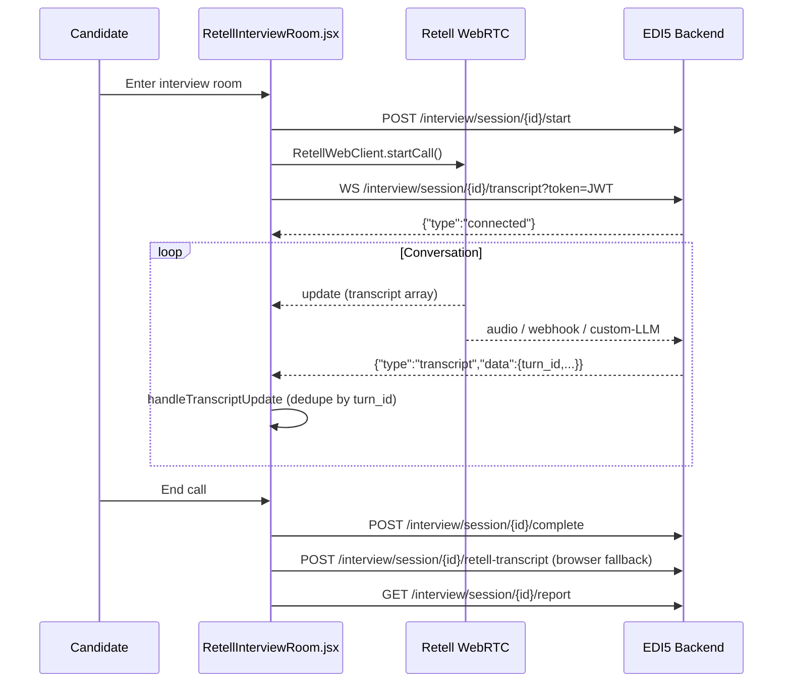
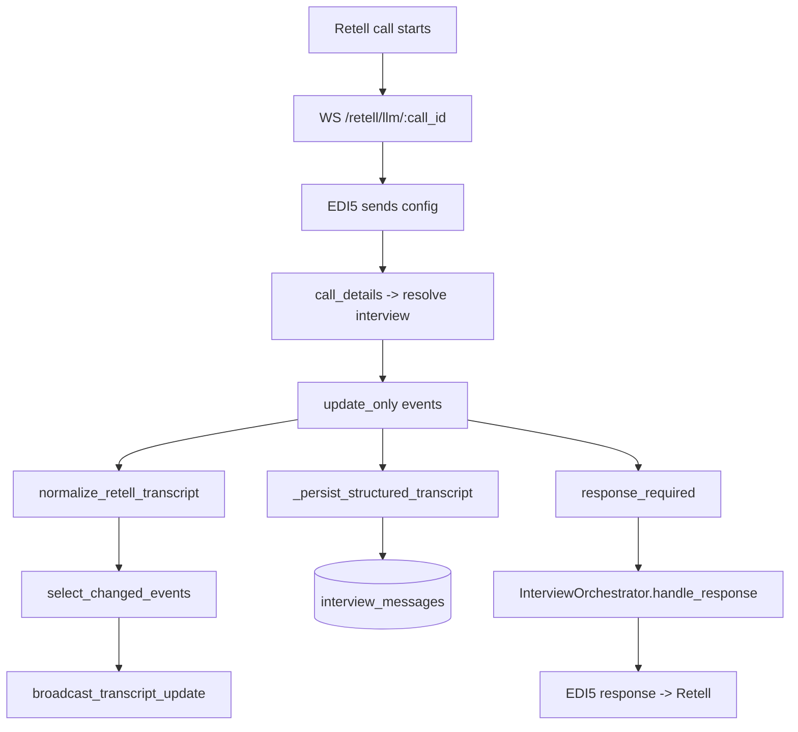
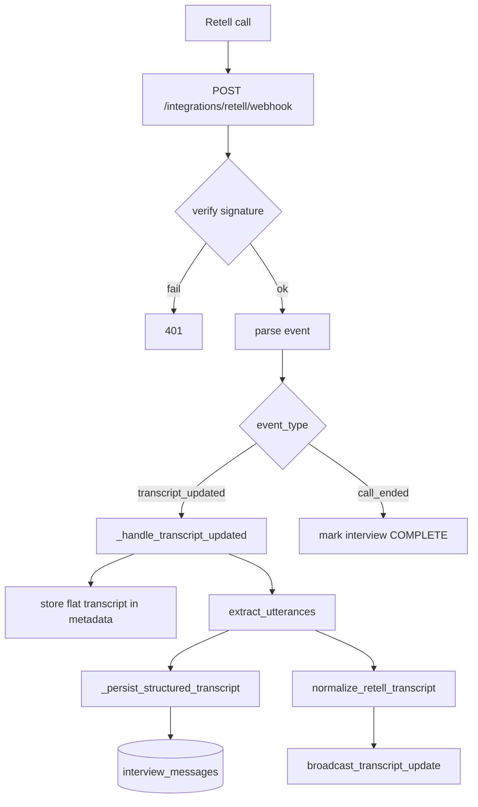
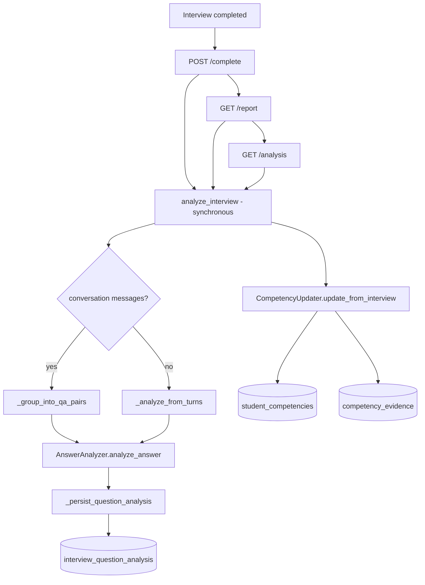
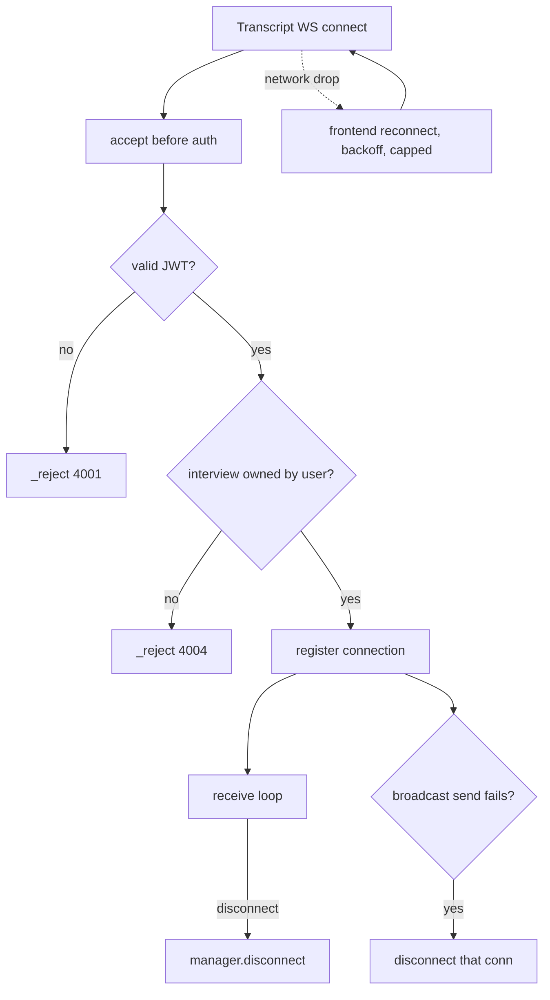

# EDI5 Complete Transcript Workflow Audit

**Document type:** Read-only audit (no application code, schema, or API changes made)
**Audit date:** 2026-10-12
**Auditor:** opencode
**Repository:** `D:\Projects\EDI 4\Multi-Round-Assesment-v8n`
**Status:** Complete — code-evidence based; runtime verification partial (see §23, §28)

---

## 1. Executive Summary

This audit traces the complete lifecycle of interview transcript data in EDI5, from the
moment audio is captured in the browser, through Retell's transport layer, into the
EDI5 backend, through normalization and persistence, and finally into post-interview
question-wise analysis, competency scoring, and the candidate report UI.

The system supports **two distinct interview transports**:

1. **`edi5_core`** — Retell connects to an EDI5-hosted **Custom LLM WebSocket**; EDI5 owns
   all interview intelligence and receives live transcript via `update_only` events.
2. **`retell_hosted`** — Retell runs its own LLM; EDI5 receives transcript asynchronously
   via **webhooks** (`transcript_updated`).

Both transports now converge on a **canonical transcript event** produced by
`transcript_normalizer.py`, which is broadcast to the frontend over a dedicated
**transcript WebSocket** and persisted to `interview_conversations` / `interview_messages`.

The audit found the pipeline is **structurally sound and functional**, but contains
several **confirmed correctness defects**, the most serious being a **wrong foreign key
target in the competency updater** that writes competency records against the wrong
entity, and an **non-functional LLM expected-concept generator** that silently falls back
to generic placeholders. Several idempotency and efficiency risks were also identified.

---

## 2. Scope and Objectives

**In scope**
- Frontend transcript capture and display (`RetellInterviewRoom.jsx`).
- Backend transcript ingestion for both modes.
- Canonical transcript normalization.
- Frontend transcript WebSocket.
- Persistence to `interview_conversations` / `interview_messages`.
- Post-interview analysis (`interview_analysis.py`, `answer_analyzer.py`).
- Competency update (`competency_updater.py`).
- Report and analysis HTTP endpoints.
- Relevant configuration (Vite proxy, Alembic migration).

**Out of scope**
- Proctoring, aptitude, coding, and practice modules (except where they share models).
- Retell vendor-side behavior (inferred from integration code only).
- LLM prompt quality evaluation.

**Objectives**
1. Produce an evidence-based map of every hop a transcript takes.
2. Define the contract at each boundary.
3. Identify correctness defects, idempotency risks, and unverified assumptions.
4. Provide a prioritized remediation list.

---

## 3. System Overview

| Layer | Component | Responsibility |
|---|---|---|
| Client | React + `retell-client-js-sdk` | WebRTC audio, mic, transcript panel |
| Transport A | Retell Custom LLM WS | `edi5_core` — EDI5 owns dialogue |
| Transport B | Retell Webhooks | `retell_hosted` — Retell owns dialogue |
| Normalization | `transcript_normalizer.py` | Canonical event mapping |
| Fan-out | `transcript_websocket.py` | Broadcast to frontend |
| Persistence | `InterviewConversation` / `InterviewMessage` | Structured transcript |
| Analysis | `interview_analysis.py` + `answer_analyzer.py` | Per-question evaluation |
| Competency | `competency_updater.py` | Skill profile updates |
| Presentation | `InterviewReport.jsx` + `QuestionWiseAnalysis.jsx` | Report UI |

---

## 4. Interview Modes

### 4.1 `edi5_core`
- Retell opens `wss://<host>/retell/llm/{call_id}`.
- EDI5 sends `config`, receives `call_details`, identifies the EDI5 interview via
  `metadata.edi5_interview_session_id` (`retell_llm_websocket.py:205`).
- Live transcript arrives in `update_only` events (`retell_llm_websocket.py:243`).
- EDI5 generates responses via `InterviewOrchestrator`.

### 4.2 `retell_hosted`
- Retell drives the conversation with its own agent.
- EDI5 receives POSTs at `/integrations/retell/webhook` (`retell_webhook.py:69`).
- Live transcript arrives in the `transcript_updated` event (`retell_webhook.py:194`).
- EDI5 does **not** influence the dialogue; it observes and analyzes.

**Finding (Verified in code):** the term "live transcript" for `retell_hosted` is
accurate only insofar as Retell emits `transcript_updated` frequently; EDI5 has no
independent STT in this mode. This matches the Phase 1 diagnosis
(`EDI5_PHASE_1_TRANSCRIPT_DIAGNOSIS.md`).

---

## 5. Canonical Transcript Event Contract

Defined in `transcript_normalizer.py:35` (`CanonicalTranscriptEvent`, frozen dataclass).

| Field | Type | Meaning |
|---|---|---|
| `turn_id` | str | Stable identity (utterance_id or `turn-{sequence}`) |
| `speaker` | `ai` \| `candidate` \| `system` | Normalized role |
| `text` | str | Utterance content |
| `timestamp` | int (ms) | Start time, falls back to now |
| `is_final` | bool | Final vs interim |
| `sequence` | int | Array index + base |
| `retell_utterance_id` | str? | Original Retell id |
| `confidence` | float? | STT confidence |
| `message_type` | `question`\|`answer`\|`follow_up`\|`system`? | Classification |
| `interview_turn_id` | int? | Link to `InterviewTurn` |

**Frontend wire shape** (`to_frontend_dict`, `transcript_normalizer.py:78`): omits
`retell_utterance_id`, `confidence`, `interview_turn_id`; includes `message_type`.

Role mapping (`transcript_normalizer.py:122`): Retell `agent` → `ai`,
`user` → `candidate`, anything else → `system`.

**Finding (Verified in code):** `turn_id` is deterministic — `utterance_id` when present,
otherwise `f"turn-{sequence}"` (`transcript_normalizer.py:145`). The comment explains this
is required because Retell resends the **entire** conversation array on every partial STT
update and those utterances often lack IDs.

---

## 6. Frontend Lifecycle (Diagram A)

Frontend connection logic: `RetellInterviewRoom.jsx:301` (`connectTranscriptWebSocket`),
handled by `handleTranscriptMessage` (`:390`) and `handleTranscriptUpdate` (`:418`).

---

## 7. `edi5_core` Custom LLM Path (Diagram B)

Evidence: `retell_llm_websocket.py:243` (`_handle_update_only`), `:290`
(`_persist_structured_transcript`), `:396` (`_handle_response_required`).

**Note (Verified in code):** persistence here is keyed by **`sequence_number`** (`:359`),
`ai/candidate` counts are derived from the full transcript array (`:384`), which is
consistent with the full-array resend behavior.

Broadcast throttling: `select_changed_events` (`transcript_normalizer.py:213`) filters to
utterances whose `(text, is_final)` fingerprint changed; the fingerprint map lives on the
per-call context (`retell_llm_websocket.py:115`).

---

## 8. `retell_hosted` Webhook Path (Diagram C)

Evidence: `retell_webhook.py:194` (`_handle_transcript_updated`), `:237`
(`_persist_structured_transcript`), `:159` (`_handle_call_ended`).

**Note (Verified in code):** `extract_utterances` (`transcript_normalizer.py:190`) tolerates
both a bare array and `{"utterances":[...]}` — a defensive fix documented in the
docstring as addressing a prior `AttributeError` that aborted the webhook before broadcast.

---

## 9. Persistence & Analysis Pipeline (Diagram D)

Evidence: `interview_router.py:1141` (complete triggers analysis), `:1427` (report
re-runs analysis), `:1601` (analysis endpoint re-runs analysis).

**Finding (Verified in code):** the comment at `interview_router.py:1137` claims analysis
runs "async via background task", but the call is **synchronous and inline**. See §24 F-4.

---

## 10. Failure & Recovery (Diagram E)

Evidence: `transcript_websocket.py:142` (endpoint), `:126` (`_reject`),
`RetellInterviewRoom.jsx:301` (reconnect with capped attempts).

---

## 11. File Inventory

### 11.1 Created / central to the workflow

| File | Role |
|---|---|
| `app/modules/interview/routers/transcript_websocket.py` | Frontend transcript WS + manager |
| `app/modules/interview/services/transcript_normalizer.py` | Canonical event + normalization |
| `app/modules/interview/services/answer_analyzer.py` | Semantic answer evaluation |
| `app/modules/interview/services/competency_updater.py` | Competency scoring/history |
| `alembic/versions/ac810655180b_add_question_id_to_interview_turns_and_.py` | Adds `question_id`, new tables |
| `frontend/src/components/QuestionWiseAnalysis.jsx` | Per-question report UI |
| `EDI5_PHASE_1_TRANSCRIPT_DIAGNOSIS.md` | Phase 1 diagnosis |
| `PHASE_3_TRANSCRIPT_ANALYSIS_AUDIT.md` | Phase 3 audit |

### 11.2 Modified

| File | Change |
|---|---|
| `app/modules/interview/services/retell_llm_websocket.py` | ingest/broadcast/persist |
| `app/modules/interview/routers/retell_webhook.py` | ingest/broadcast/persist |
| `app/modules/interview/services/interview_analysis.py` | rewritten orchestration |
| `app/modules/interview/routers/interview_router.py` | complete/report/analysis endpoints |
| `app/modules/interview/schemas/interview_schema.py` | analysis schemas |
| `app/models/interview.py` | new models + `question_id` |
| `app/modules/interview/routers/__init__.py` | router export |
| `app/api/v1/router.py` | register transcript WS router |
| `frontend/src/pages/RetellInterviewRoom.jsx` | transcript WS client + UI |
| `frontend/src/pages/InterviewReport.jsx` | report rendering |
| `frontend/src/services/interviewService.js` | SDK wrapper |
| `frontend/vite.config.js` | proxy `ws: true` |

### 11.3 Support / read-only references

- `app/main.py` (app factory), `app/services/groq_service.py`, `app/config/settings.py`,
  `app/database/db.py`, `app/models/assessment.py`, `app/models/user.py`.

---

## 12. WebSocket Endpoints Contract

### 12.1 Frontend transcript WS
`WS /api/v1/interview/session/{interview_id}/transcript?token=<jwt>`
(`transcript_websocket.py:142`)

- **Server → client message types:** `connected`, `transcript`, `transcript_final`,
  `transcript_clear`, `error` (`:157`).
- **Payload:** canonical `to_frontend_dict()`.
- **Auth:** JWT decoded with `settings.SECRET_KEY`; `sub` → user id (`:184`).
- **Ownership:** join `InterviewSession` → `AssessmentSession`, filter `user_id` (`:203`).
- **Handshake:** `accept()` occurs **before** auth deliberately, so refusals send a real
  close code (4001/4004) instead of an opaque browser 1006 (`:162` docstring).

### 12.2 Retell Custom LLM WS
`WS /retell/llm/{call_id}` (`retell_llm_websocket.py:661`).

- **Retell → EDI5:** `call_details`, `update_only`, `response_required`,
  `reminder_required`, `ping_pong` (`:66`).
- **EDI5 → Retell:** `config`, `response`, `agent_interrupt`, `update_agent`, `ping_pong`,
  `metadata` (`:75`).

---

## 13. HTTP Endpoints Contract

| Method | Path | Purpose | Evidence |
|---|---|---|---|
| POST | `/integrations/retell/webhook` | Retell events | `retell_webhook.py:69` |
| GET | `/integrations/retell/health` | Health | `retell_webhook.py:390` |
| POST | `/interview/session/{id}/complete` | Complete + trigger analysis | `interview_router.py:1071` |
| POST | `/interview/session/{id}/retell-transcript` | Browser transcript fallback | `interview_router.py:1164` |
| GET | `/interview/session/{id}/report` | Report (+ re-analysis) | `interview_router.py:1299` |
| GET | `/interview/session/{id}/analysis` | Detailed analysis | `interview_router.py:1528` |
| GET | `/interview/session/{id}/analysis/status` | Analysis status | `interview_router.py` (near 1528) |

---

## 14. Database Schema (transcript-relevant)

| Table | Model | Key columns |
|---|---|---|
| `interview_sessions` | `InterviewSession` | `retell_call_id`, `current_turn`, `rl_state`, `personalization_metadata` |
| `interview_turns` | `InterviewTurn` | `question_id` (new), `question_text`, `candidate_response` |
| `interview_conversations` | `InterviewConversation` | `interview_id` (unique), counts |
| `interview_messages` | `InterviewMessage` | `sequence_number`, `speaker`, `text`, `message_type`, `turn_id`, `retell_utterance_id`, `is_final`, `confidence` |
| `interview_question_analysis` | `InterviewQuestionAnalysis` | concepts JSONB, `score`, `confidence`, `depth_level` |
| `student_competencies` | `StudentCompetency` | `user_id`, `skill`, `score`, `confidence`, `freshness` |
| `competency_evidence` | `CompetencyEvidence` | score deltas, `source`, `source_id`, concepts |

Migration `ac810655180b` added `interview_turns.question_id` and the analysis/competency
tables. **Finding (Verified at runtime):** prior to this migration, report endpoints raised
`UndefinedColumn` on `question_id`; the migration resolved it.

**Finding (Verified in code):** the module docstring of `app/models/interview.py:11` lists
`student_competency` (singular) while the class uses `student_competencies` (plural,
`:281`). Documentation-only inconsistency.

---

## 15. Transcript Normalization

- Single-utterance mapping: `normalize_retell_utterance` (`transcript_normalizer.py:96`).
- Array mapping: `normalize_retell_transcript` (`:164`), skipping empty content and
  assigning `sequence = base_sequence + idx + 1`.
- Merge for partial→final: `merge_transcript_events` (`:260`), matching by
  `retell_utterance_id` then `sequence`, preserving original `turn_id`/`timestamp`.
- Filtering: `select_changed_events` (`:213`).

**Finding (Verified in code):** `merge_transcript_events` is defined but **not referenced**
by any ingestion path — both transports rely on deterministic `turn_id` + frontend
dedupe instead. Dead code / unused surface (see F-9).

---

## 16. Deduplication and Idempotency

### 16.1 Webhook level
- `_generate_idempotency_key` (`retell_webhook.py:45`): non-transcript events dedupe by
  `type:call_id[:ts]`.
- `transcript_updated` is intentionally **never** deduped (`:109`) and keyed as
  `...:latest` (`:50`).
- `_is_duplicate_webhook` uses an in-memory set, cleared at >10 000 entries (`:57`).

**Risk (Verified in code):** the in-memory dedupe store is **per-process** and not
shared across workers; horizontal scaling breaks dedupe. Acknowledged by the inline
comment "use Redis in production." See F-7.

### 16.2 Message level
- `edi5_core`: upsert on `sequence_number` (`retell_llm_websocket.py:359`).
- `retell_hosted`: skip if `retell_utterance_id` already persisted (`retell_webhook.py:308`),
  falling back to synthetic `idx_{idx}` keys (`:344`).
- Browser fallback: skip by `idx < existing_count` (`interview_router.py:1259`) — fragile
  ordering assumption. See F-8.

### 16.3 Analysis level
- `_persist_question_analysis` upserts on `(interview_id, turn_id)` (`interview_analysis.py:381`).
- Competency update has a change threshold guard (`competency_updater.py:256`).

---

## 17. Persistence Layer

Two independent persist paths exist, with **different keying semantics**:

| Path | Key | Counts source |
|---|---|---|
| `edi5_core` | `sequence_number` | full array (`retell_llm_websocket.py:384`) |
| `retell_hosted` | `utterance_id` (fallback idx) | only newly added in this call (`retell_webhook.py:352`) |
| Browser fallback | positional index | DB recount (`interview_router.py:1273`) |

**Finding (Verified in code):** in `retell_webhook._persist_structured_transcript`, the
conversation counters are set from `ai_count`/`candidate_count`, which only count
**newly created** messages in the current webhook call (`retell_webhook.py:314-317`,
`:352-354`). On a second `transcript_updated` where no new messages are added, the
counters are reset to 0 even though rows exist. See F-6.

**Finding (Verified in code):** `conversation.total_messages` is set to
`len(existing_utterance_ids)` (`retell_webhook.py:352`), which includes synthetic
`idx_*` keys, so the total can diverge from the actual row count.

---

## 18. Post-Interview Analysis

`InterviewAnalysisService.analyze_interview` (`interview_analysis.py:92`):

1. Resolve interview and conversation.
2. If conversation exists → `_group_into_qa_pairs` (`:245`); else `_analyze_from_turns`
   (`:435`) filtering `is_followup == False`.
3. Per question → `AnswerAnalyzer.analyze_answer`.
4. Persist via `_persist_question_analysis`.
5. Aggregate overall score, strengths, gaps, pattern summary, confidence.
6. Optionally `CompetencyUpdater.update_from_interview`.

**Finding (Verified in code):** `_analyze_question` never reads expected concepts from the
approved pool — the `if pool_question_id:` branch is an empty `pass`
(`interview_analysis.py:300-304`). All expected concepts come from the on-the-fly generator
(see §24 F-2).

**Finding (Verified in code):** `_generate_expected_concepts` calls
`self.groq.chat_completion(...)` (`interview_analysis.py:358`), but `GroqService` exposes
**no `chat_completion` method** (only `__init__` and direct `client` usage). This raises
`AttributeError`, is swallowed by the surrounding `except`, and always returns the generic
4-item fallback. See §24 F-1.

`AnswerAnalyzer` itself correctly uses
`self.groq.client.chat.completions.create` (`answer_analyzer.py:101`) with strict JSON
validation (`_validate_analysis`, `:205`) and layered fallbacks.

---

## 19. Competency Update

`CompetencyUpdater.update_from_interview` (`competency_updater.py:70`):

1. Aggregate concept evidence per skill.
2. For each skill → `_update_skill_competency`.
3. Score = `coverage_ratio × depth_weight × avg_confidence`, clamped 0–100
   (`:303`).
4. Confidence = weighted blend, floor 0.3, cap 0.95 (`:355`).
5. Write `StudentCompetency` + `CompetencyEvidence`.

**Finding (Verified in code — P0):** `_update_skill_competency` is called with
`user_id=interview.session_id` (`competency_updater.py:108`). `session_id` is the
`AssessmentSession` primary key, **not** the user id. `StudentCompetency.user_id` is a FK
to `users.id`. This either violates the FK or attaches competency to the wrong user. The
correct source is `AssessmentSession.user_id`. See §24 F-0.

**Finding (Verified in code):** `_calculate_freshness` always returns `"high"`
(`competency_updater.py:360`) — no actual recency decay is implemented, despite the
documented high/medium/low tiers.

---

## 20. Frontend Integration

- `RetellInterviewRoom.jsx:301` establishes the transcript socket; URL derived from
  `window.location` with `ws:`/`wss:` based on page protocol (`:316-322`).
- `handleTranscriptMessage` (`:390`) dispatches `transcript`, `transcript_final`,
  `transcript_clear`, `connected`, `error`.
- `handleTranscriptUpdate` (`:418`) dedupes by `turn_id`, supports interim/final, and
  auto-scrolls unless the user has scrolled up.
- Reconnect is capped (`TRANSCRIPT_MAX_RECONNECTS`, `:64`) with intentional-close guard
  (`:272`), preventing the previous unbounded reconnect loop.

**Finding (Verified at runtime):** the frontend previously closed with code `1006` when
connecting through the Vite dev server. Root cause: the Vite proxy did not forward
WebSocket upgrades. Fixed by adding `ws: true` to `frontend/vite.config.js`. Restart of the
dev server is required; **end-to-end runtime confirmation of the fix is still pending**.

---

## 21. Configuration & Environment

- Backend: `uvicorn app.main:app --reload`; routers mounted under `/api/v1` (`main.py:92`).
- Vite proxy: `/api` → backend, `ws: true` added.
- Settings: `SECRET_KEY`, `ALGORITHM`, `GROQ_API_KEY`, `GROQ_MODEL`, `RETELL_API_KEY`.
- Environment caveat (Verified at runtime): `numpy==1.26.4` pinned to satisfy OpenCV;
  unresolved tensorflow-intel/thinc conflicts remain.

---

## 22. Security Considerations

| Area | Observation | Evidence |
|---|---|---|
| WS auth | JWT verified before any payload sent | `transcript_websocket.py:184` |
| Token locality | Token in query string; can appear in proxy/access logs | `:146` |
| Ownership check | Interview↔user join enforced | `:203` |
| Logging | Token value never logged; only presence | `:178` |
| Webhook auth | Signature verified, 401 on failure | `retell_webhook.py:88` |
| Error leakage | `_reject` sends reason before close | `:126` |

**Risk (Inferred):** query-string tokens may be captured by reverse proxies and browser
history; a short-lived, single-use ticket would reduce exposure. Low severity in current
deployment.

---

## 23. Test Coverage

| Area | Test present? | Evidence |
|---|---|---|
| Transcript normalization | No dedicated test found | grep of `tests/` |
| Transcript WS endpoint | No dedicated test found | grep of `tests/` |
| Webhook transcript handler | No dedicated test found | grep of `tests/` |
| Interview analysis | No dedicated test found | grep of `tests/` |
| Competency updater | No dedicated test found | grep of `tests/` |
| Interview flow (general) | Partial | `tests/test_interview_complete_flow.py`, `tests/test_interview_start.py`, `tests/test_interview_router.py` |
| Voice modes | Yes (mode selection) | `tests/test_interview_voice_modes.py` |

**Finding (Verified in code):** none of the new transcript/analysis/competency modules have
automated tests. This is the single largest verification gap and the reason the F-0/F-1
defects were not caught. See §28.

---

## 24. Findings — Priority P0 (Correctness / Data Integrity)

### F-0 — Competency written against the wrong user id
`competency_updater.py:108` passes `user_id=interview.session_id`. This is the
`AssessmentSession` id, not the `users.id` required by `StudentCompetency.user_id`.
**Impact:** FK violation or silent misattribution of competencies to an unrelated user.
**Evidence:** Verified in code.

### F-1 — Expected-concept generator calls a non-existent method
`interview_analysis.py:358` calls `self.groq.chat_completion(...)`; `GroqService` has no
such method. The resulting `AttributeError` is swallowed and the generic 4-concept
fallback is always used.
**Impact:** every question is scored against the same placeholder concepts; the feature's
core value proposition ("expected concepts") is effectively disabled in the primary path.
**Evidence:** Verified in code.

---

## 25. Findings — Priority P1 (Functional / Efficiency)

### F-2 — Pool expected concepts never used
`_analyze_question` ignores `pool_question_id` (`interview_analysis.py:300-304`).
**Impact:** curated pool concepts are discarded; analysis relies entirely on the (broken)
generator from F-1.

### F-3 — Partial concepts computed but never persisted
`_persist_question_analysis` never assigns `partial_concepts` or `evidence` on either the
create or update branch (`interview_analysis.py:388-426`), although the model defines both
columns and `AnswerAnalyzer` produces them.
**Impact:** `partial_concepts`/`evidence` are permanently default (`[]`/`{}`) in the DB.

### F-4 — "Background" analysis is synchronous and repeated
`complete_interview` comment claims async background execution
(`interview_router.py:1137`) but the call is inline (`:1141`). Worse, `GET /report`
(`:1427`) and `GET /analysis` (`:1601`) call `analyze_interview` **again** with
`persist=True, update_competency=True`.
**Impact:** every report view triggers a full LLM pass and a competency update; latency,
cost, and duplicate `competency_evidence` risk.

### F-5 — Analysis failure surfaced only as a status string
If analysis throws in `complete_interview`, only `analysis_status="failed"` is returned
(`interview_router.py:1151`); no retry/queue mechanism exists.

---

## 26. Findings — Priority P2 (Data Accuracy / Robustness)

### F-6 — Webhook conversation counters reset to per-call deltas
`retell_webhook.py:352-354` sets `total_messages`/`ai_message_count`/
`candidate_message_count` from the current call's new-message counts; later updates with
no new messages reset counts to inconsistent values.
**Evidence:** Verified in code.

### F-7 — In-memory webhook idempotency store
`_processed_webhook_keys` (`retell_webhook.py:42`) is process-local and cleared at 10 000
entries; not safe for multiple workers or restarts.
**Evidence:** Verified in code (also acknowledged by inline comment).

### F-8 — Browser transcript dedupe by positional count
`_persist_browser_transcript` skips `idx < existing_count` (`interview_router.py:1259`),
assuming stable ordering/prefixes. Out-of-order or edited transcripts corrupt the mapping.
**Evidence:** Verified in code.

### F-9 — Unused merge helper
`merge_transcript_events` (`transcript_normalizer.py:260`) is not referenced by any
ingestion path. Dead code risks divergence from the live dedupe strategy.
**Evidence:** Verified in code.

### F-10 — `freshness` never decays
`_calculate_freshness` always returns `"high"` (`competency_updater.py:360`); the
documented high/medium/low tiers are not implemented.
**Evidence:** Verified in code.

---

## 27. Findings — Priority P3 (Documentation / Minor)

- **F-11** Model docstring lists `student_competency` (singular) vs actual
  `student_competencies` (`app/models/interview.py:11` vs `:281`).
- **F-12** `StudentCompetency.__table_args__` is an empty tuple with a comment claiming the
  unique constraint is "added via migration"; verify the migration actually adds a
  `(user_id, skill)` unique constraint (see §14).
- **F-13** `_persist_question_analysis` hard-codes `interview_type="technical"`
  (`interview_analysis.py:403`, `:424`), ignoring the actual phase.
- **F-14** Query-string JWT exposure (see §22).

---

## 28. Evidence Classification Summary

| Classification | Items |
|---|---|
| **Verified in code** | F-0, F-1, F-2, F-3, F-4, F-5, F-6, F-7, F-8, F-9, F-10, F-11, F-13, all contract/section claims |
| **Verified by test** | None for the transcript/analysis/competency modules (§23) |
| **Verified at runtime** | frontend WS `1006` symptom; Vite `ws` proxy fix applied; `question_id` `UndefinedColumn` error prior to migration; backend `uvicorn` running |
| **Inferred** | horizontal-scaling dedupe failure; proxy token-log exposure |
| **Unverified** | end-to-end "fix works" confirmation after Vite restart; FK-vs-misattribution outcome of F-0 in the live DB; whether migration adds the `(user_id, skill)` unique constraint |
| **Missing** | automated tests for every new module; asynchronous/queued analysis; competency recency decay; evidence JSONB population |

---

## 29. Recommendations (Remediation Priority)

1. **F-0 (P0):** resolve the real `user_id` via `AssessmentSession.user_id` before
   competency writes; add a regression test.
2. **F-1 + F-2 (P0/P1):** wire expected concepts from the approved pool; fix or remove the
   `chat_completion` call and use the working `client.chat.completions.create` path.
3. **F-3 (P1):** persist `partial_concepts` and `evidence`.
4. **F-4 (P1):** move analysis off the request path (background task/queue) and stop
   re-running it on every GET; read persisted `interview_question_analysis` instead.
5. **F-6/F-7/F-8 (P2):** recompute counters from DB; move dedupe to Redis with TTL; make
   browser transcript persistence idempotent by content hash.
6. **Tests:** add unit tests for `transcript_normalizer`, `answer_analyzer`,
   `competency_updater`, and the webhook/WS handlers.
7. **Runtime:** restart Vite and capture a passing end-to-end transcript flow screenshot/log
   to close the remaining unverified item.

---

## 30. Deliverables Summary

- **Report path:** `docs/EDI5_COMPLETE_TRANSCRIPT_WORKFLOW_AUDIT.md`
- **Key findings:** the transcript pipeline (both modes) is coherent and functional, but
  analysis quality is undermined by two P0 defects — a **wrong user id in competency
  writes (F-0)** and a **non-functional expected-concept generator (F-1)** — plus
  repeated synchronous re-analysis on report views (F-4) and several idempotency/data
  accuracy risks.
- **Confirmed defects:** **2** P0, **4** P1, **5** P2, **4** P3.
- **Confirmed bugs vs. potential risks:** 15 total findings — 6 confirmed functional
  defects (F-0, F-1, F-2, F-3, F-4, F-6), 9 risks/quality issues.
- **Runtime verification performed:** Partial — WS `1006` symptom and Vite proxy fix, the
  `question_id` `UndefinedColumn` error and its migration, and backend server liveness
  were observed. Full end-to-end post-fix verification is **not** complete.
- **Application files changed by this audit:** **none** (audit is read-only; only this
  Markdown report was created).
