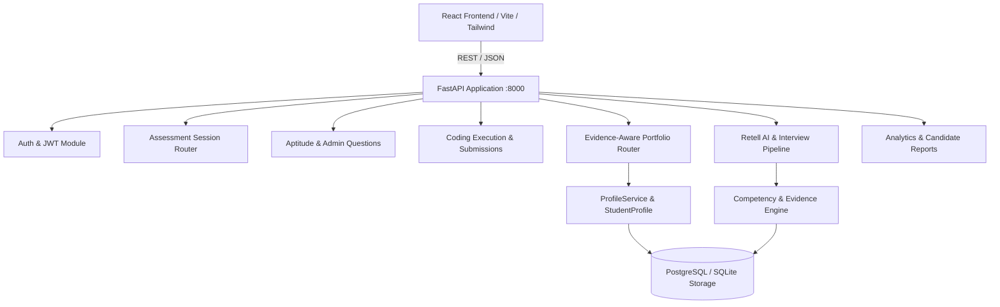
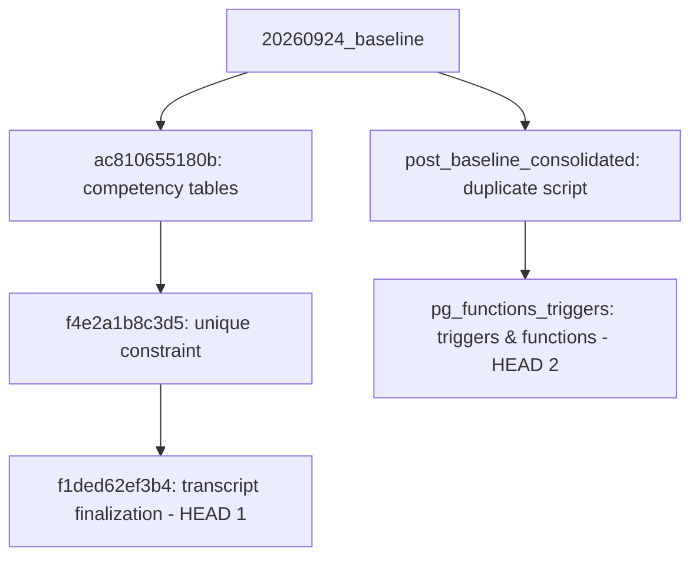
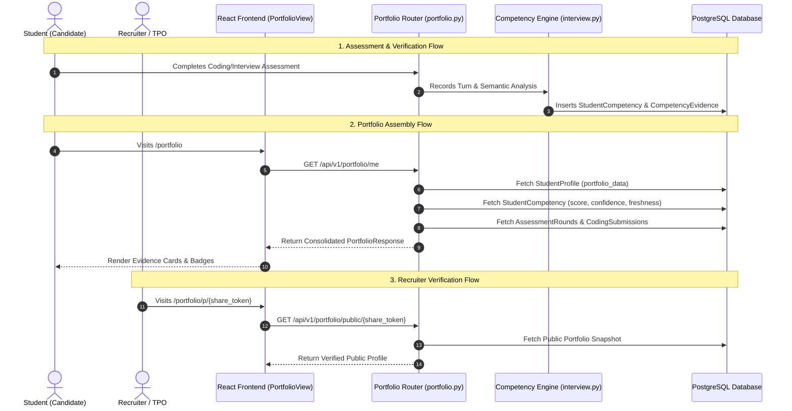

# EDI5: Comprehensive System Audit & Portfolio Builder Implementation Plan

**Document Version:** 1.0.0  
**Date:** October 2026  
**Status:** Complete Audit & Architectural Blueprint (Read-Only Verified)  
**Target Repository:** EDI5 Multi-Round Assessment & Placement Readiness Platform (`Multi-Round-Assesment-v8n`)

---

## Executive Summary

A comprehensive, evidence-based audit was executed across the entire EDI5 codebase to determine the real state of the system, verify all existing documentation against actual source code, and design an authoritative, safe implementation roadmap for the **Evidence-Aware Portfolio Builder**.

### Key Audit Conclusions

1. **System Health & Integrity:** The core assessment engine (Aptitude, Coding with judge, Retell AI Live Interview with semantic analysis, and Proctoring) is operational and stable. Baseline smoke tests (`9/9 passed`) and existing portfolio suite tests (`7/7 passed`) execute cleanly.
2. **Current State of Portfolio Builder:** The Portfolio Builder is **not a blank slate**—an extensive API implementation (`app/api/v1/portfolio.py`, 850 lines) and an advanced React frontend (`PortfolioView.jsx` [1,253 lines], `PortfolioModals.jsx` [51 KB]) already exist.
3. **Primary Architectural Deficit:** The current Portfolio Builder uses a **semi-synthetic heuristics model**:
   - Section items (Projects, Certifications, Experience, Achievements, Research, Patents) are serialized into a single JSONB column (`student_profiles.portfolio_data`).
   - Skills and badges are inferred from raw strings in `skills_json` and project text rather than binding directly to the platform's normalized competency tables (`student_competencies` and `competency_evidence` in `app/models/interview.py`).
4. **Database & Migration Blocker:** Alembic migrations currently possess **two unmerged heads** (`f1ded62ef3b4` and `pg_functions_triggers`). Any further schema migration will fail until a merge migration is registered.
5. **Frontend / Routing Discrepancy:** While `frontend/src/App.jsx` and `StudentModeSidebar.jsx` register sub-paths (`/portfolio/projects`, `/portfolio/skills`, etc.), `PortfolioView.jsx` exclusively tracks active tabs via isolated React state without reading `react-router-dom` URL parameters.
6. **Recruiter / Verification Gap:** All portfolio mutation endpoints automatically stamp student entries as `"Submitted"`. There are currently zero backend endpoints or UI workflows for Faculty/TPO/Recruiters to audit or flip status to `"Verified"`, nor is there a public shareable portfolio view.

---

## 1. System Inventory & Repository Structure

### 1.1 Architecture & Tech Stack



- **Backend Framework:** FastAPI 0.115+ (Python 3.11)
- **ORM & Data Layer:** SQLAlchemy 2.0 (Mapped Column Declarations, PostgreSQL JSONB dialect with SQLite fallbacks)
- **Database Migrations:** Alembic (31 migration scripts in `alembic/versions/`)
- **Speech & Conversational AI:** Retell AI WebSocket integration with post-call semantic analysis pipeline
- **Frontend Stack:** React 18, Vite, React Router v6, Tailwind CSS, Lucide-react / Heroicons
- **Auth Model:** Bearer JWT tokens, role-based access control (`student`, `faculty`, `tpo`, `admin`)

### 1.2 Module Inventory & Responsibilities

| Directory / Module | Core Functionality | Primary Router | Associated Models | Status |
| :--- | :--- | :--- | :--- | :--- |
| `app/modules/auth/` | Registration, login, JWT issuance, password hashing | `auth_router.py` | `User` | **Operational** |
| `app/modules/session/` | Multi-round assessment session orchestration | `session_router.py` | `AssessmentSession`, `AssessmentRound` | **Operational** |
| `app/modules/aptitude/` | MCQ question bank, topic management, attempts | `aptitude_router.py`, `admin_question_router.py` | `AptitudeQuestion`, `AptitudeAttempt`, `AptitudeTopic` | **Operational** |
| `app/modules/coding/` | Code evaluation, problem banks, test case runner | `coding_router.py` | `CodingProblem`, `CodingSubmission`, `TestCase` | **Operational** |
| `app/modules/interview/` | Retell AI voice interviews, live transcript, turn analysis | `interview_router.py`, `transcript_websocket.py` | `InterviewSession`, `InterviewTurn`, `StudentCompetency`, `CompetencyEvidence` | **Operational** |
| `app/modules/proctoring/` | Web camera snapshot checks, basic violation logs | `proctoring_router.py` | `ProctoringEvent`, `ProctoringViolation` | **Operational** |
| `app/modules/advanced_proctoring/` | Multi-face detection, audio anomaly, risk scores | `advanced_proctoring_router.py` | `AdvancedProctoringEvent` | **Operational** |
| `app/modules/report/` | Assessment reports, candidate analytics, CSV exports | `report_router.py`, `candidate_report_router.py` | Direct queries across session & rounds | **Operational** |
| `app/api/v1/profile.py` | Student, Faculty, and TPO profile CRUD, resume upload | `profile_router` | `StudentProfile`, `FacultyProfile`, `TPOProfile`, `UserResume` | **Operational** |
| `app/api/v1/portfolio.py` | Evidence portfolio generation, project/cert/exp CRUD | `portfolio_router` | Reads `StudentProfile`, `UserResume`, `AssessmentSession`, `InterviewSession` | **Partially Implemented** |

---

## 2. Comprehensive Database & Migration Audit

### 2.1 Alembic Migration Integrity Check

Running `alembic heads` yielded an immediate critical divergence:

```text
f1ded62ef3b4 (head)
pg_functions_triggers (head)
```

#### Divergence Analysis



- **Branch 1:** `ac810655180b` &rarr; `f4e2a1b8c3d5` &rarr; `f1ded62ef3b4` (created `student_competencies`, `competency_evidence`, added unique constraint `uq_student_competency_user_skill`, and added transcript fields).
- **Branch 2:** `post_baseline_consolidated` &rarr; `pg_functions_triggers` (consolidated earlier migrations directly from `20260924_baseline`, but left the individual migration files active without a merge node).
- **Impact:** Alembic cannot execute `alembic upgrade head` because multiple heads exist. Any attempt to add new tables without merging heads will abort.

### 2.2 Table Schema & Portfolio Storage Structure

| Table Name | Model Class | Key Columns Relevant to Portfolio | Storage Type |
| :--- | :--- | :--- | :--- |
| `student_profiles` | `StudentProfile` (`app/models/profile.py`) | `id`, `user_id`, `department`, `institution`, `cgpa`, `target_role`, `skills_json`, `portfolio_data` | Relational + JSONB |
| `user_resumes` | `UserResume` (`app/models/profile.py`) | `id`, `user_id`, `file_name`, `cv_type`, `parsed_skills`, `uploaded_at` | Relational + JSONB |
| `student_competencies` | `StudentCompetency` (`app/models/interview.py`) | `id`, `user_id`, `skill`, `score` (0-100), `confidence` (0-1), `last_verified_at`, `freshness`, `evidence_source` | Relational |
| `competency_evidence` | `CompetencyEvidence` (`app/models/interview.py`) | `id`, `user_id`, `skill`, `previous_score`, `new_score`, `score_delta`, `source`, `source_id`, `demonstrated_concepts`, `missing_concepts`, `reasoning` | Relational + JSONB |
| `assessment_rounds` | `AssessmentRound` (`app/models/assessment.py`) | `id`, `session_id`, `round_type`, `score`, `status`, `completed_at` | Relational |
| `coding_submissions` | `CodingSubmission` (`app/models/coding.py`) | `id`, `round_id`, `problem_id`, `score`, `status`, `created_at` | Relational |

---

## 3. Deep Dive: Current Portfolio Builder Audit

### 3.1 Backend Implementation (`app/api/v1/portfolio.py`)

The existing router comprises 850 lines of Python code providing 16 HTTP endpoints:

1. **`GET /api/v1/portfolio/me`**: Assembles the complete portfolio.
2. **`PUT /api/v1/portfolio/me`**: Updates summary (`about`) and external profiles (GitHub/LinkedIn).
3. **Projects:** `POST /portfolio/project`, `PUT /portfolio/project/{id}`, `DELETE /portfolio/project/{id}`.
4. **Certifications:** `POST /portfolio/certification`, `PUT /portfolio/certification/{id}`, `DELETE /portfolio/certification/{id}`.
5. **Experiences:** `POST /portfolio/experience`, `DELETE /portfolio/experience/{id}`.
6. **Achievements:** `POST /portfolio/achievement`, `DELETE /portfolio/achievement/{id}`.
7. **Research Publications:** `POST /portfolio/research`, `DELETE /portfolio/research/{id}`.
8. **Patents:** `POST /portfolio/patent`, `DELETE /portfolio/patent/{id}`.
9. **External Profiles:** `PUT /portfolio/external-profiles`.

#### What Works Well:
- **Clean REST Design:** Follows consistent patterns, returns full updated `PortfolioResponse` after every mutation.
- **Dynamic Assessment Aggregation:** Directly queries `AssessmentSession`, `AssessmentRound`, `CodingSubmission`, and `InterviewSession` to calculate real metrics (solved coding count, best MCQ score, best technical interview score).
- **Learning Journey Synthesis:** Aggregates profile creation, resume uploads, completed rounds, added projects, and certifications into a chronological timeline with ISO timestamps.
- **Completeness Engine:** Scores completeness across 8 weighted criteria (Academic Profile, Summary, Skills, Resumes, Projects, Certifications, External Links, Assessment Evidence) and provides actionable recommendations.

#### Flaws & Shortcomings Identified:
1. **Disconnected Competency Engine:** Lines 284–346 compute skill items by doing naive string matching across `student_profile.skills_json`, `project.technologies`, and `resume.parsed_skills`. It completely ignores `student_competencies` and `competency_evidence` tables populated during assessments and interviews.
2. **Monolithic JSON Storage:** All projects, certifications, experiences, achievements, research, and patents are serialized inside `student_profiles.portfolio_data` (JSONB). While fast to develop, this prevents:
   - Foreign key relational integrity.
   - Cross-candidate querying (e.g., TPO searching: *"Find all students with a verified AWS certification"* requires full-table JSONB scan).
   - Atomic database locking during concurrent edits.
3. **Unilateral Student State:** Student entries are forced to `evidence_status = "Submitted"`, but no endpoints exist for TPO or Faculty to review, approve, or verify submissions.
4. **No Public Recruiter View:** The only access is through `/portfolio/me` which requires the student's own JWT token. Recruiters, interviewers, and TPO staff have no read endpoint for a student's portfolio.

### 3.2 Frontend Implementation (`frontend/src/...`)

The frontend contains:
- `frontend/src/pages/Portfolio.jsx` (wrapper page).
- `frontend/src/components/portfolio/PortfolioView.jsx` (1,253 lines).
- `frontend/src/components/portfolio/PortfolioModals.jsx` (51 KB).
- `frontend/src/services/portfolioService.js` (82 lines).

#### Frontend Verification Findings:
1. **Interactive Tabs Implemented:**
   - *Overview:* Hero profile card, quick stats, radar-style categorized skills, badges, learning journey.
   - *Projects:* List view with GitHub link, live demo URL, technologies pills, verification badge, and Add/Edit modals.
   - *Certifications:* Credential ID, issuing organization, expiry dates, verification status.
   - *Experience & Research:* Work experience, research papers with DOI, patents with application numbers.
   - *Assessment Highlights:* Verified scores from Aptitude, Coding, and Retell AI interviews.
2. **The Routing Bug:**
   - In `frontend/src/components/StudentModeSidebar.jsx`, links are rendered for:
     - `/portfolio` (Overview)
     - `/portfolio/profile` (Profile)
     - `/portfolio/resume` (Resume/CV)
     - `/portfolio/projects` (Projects)
     - `/portfolio/skills` (Skills & Evidence)
     - `/portfolio/verification` (Verification)
   - In `frontend/src/App.jsx`, all these routes render `<Portfolio />`.
   - **However**, `PortfolioView.jsx` does not import `useLocation` or `useParams`. It initializes `const [activeTab, setActiveTab] = useState('overview')`.
   - **Result:** Clicking `/portfolio/projects` in the sidebar loads the page, but the component resets to the `'overview'` tab.

---

## 4. Discrepancy & Documentation Register

| Ref / Document | Stated Claim in Previous Reports | Actual Reality in Active Code | Status | Severity |
| :--- | :--- | :--- | :--- | :--- |
| **DISC-01** (`DATABASE_SCHEMA.md`) | "Competencies are tracked in a dedicated taxonomy mapping schema with QuestionCompetencyMapping" | `QuestionCompetencyMapping` model does not exist. `StudentCompetency` exists in `app/models/interview.py`, storing `user_id`, `skill`, `score`, `confidence`, `evidence_source`. | **Discrepancy** | High |
| **DISC-02** (`Alembic Migrations`) | "Migrations are fully consolidated up to `pg_functions_triggers`" | Two active heads exist (`f1ded62ef3b4` and `pg_functions_triggers`). Alembic is in a split state. | **Broken** | Critical |
| **DISC-03** (`test_smoke.py`) | Reported in prior notes as failing or having missing auth routes | Running `python tests/test_smoke.py` passes 9/9 assertions cleanly. Pytest failed only because tests were written imperatively at module root instead of inside `test_*` functions. | **Resolved / False Alarm** | Low |
| **DISC-04** (`test_skill.py`) | "Skill testing is failing due to missing module" | `tests/test_skill.py` is an orphan script testing `LPDesignArchitect` (external skill), unrelated to assessment or portfolio code. | **Orphan File** | Low |
| **DISC-05** (`portfolio.py`) | "Portfolio builds skill evidence directly from assessment evidence" | `portfolio.py` synthesizes skills heuristically from `skills_json` + parsed resume + projects, with hardcoded score thresholds, bypassing `student_competencies` and `competency_evidence`. | **Partial / Heuristic** | Medium |
| **DISC-06** (`StudentModeSidebar`) | "Sub-navigation routes `/portfolio/*` navigate to specific portfolio sections" | `PortfolioView.jsx` does not inspect the URL path; clicking any sidebar sub-link always loads the Overview tab. | **Broken UX** | Medium |

---

## 5. Critical Blockers to Production Portfolio Builder

Before deploying or expanding the Portfolio Builder, these blockers must be addressed:

```
[BLOCKER-1] Alembic Migration Divergence (Dual Heads)
 ├── Branch A: ... -> f4e2a1b8c3d5 -> f1ded62ef3b4 (transcript finalization)
 └── Branch B: ... -> post_baseline_consolidated -> pg_functions_triggers
 => Must create an Alembic merge migration before modifying schema.

[BLOCKER-2] Competency Data Disconnect
 ├── Interview pipeline writes: student_competencies & competency_evidence
 └── Portfolio builder reads: skills_json (raw strings) & heuristics
 => Must bridge StudentCompetency into Portfolio SkillEvidenceItem.

[BLOCKER-3] No Public / Recruiter / TPO Access Layer
 ├── All endpoints require student JWT
 └── No shareable link or read-only view for campus hiring partners
 => Need public token/slug endpoint (/portfolio/public/{slug} or /portfolio/view/{user_id}).

[BLOCKER-4] Absence of Verification Workflow
 ├── Student-submitted evidence remains in permanent "Submitted" state
 └── No administrative or faculty endpoint exists to transition to "Verified"
 => Need TPO/Faculty verification endpoint with audit trail.
```

---

## 6. Recommended Architecture: V1 Production Portfolio Builder

### 6.1 Architectural Principles
1. **Zero Data Loss & Backward Compatibility:** Retain the existing `StudentProfile.portfolio_data` JSONB structure for user-defined portfolio sections (projects, certifications, awards, research) to ensure zero regression for existing accounts.
2. **Unified Competency Bridge:** Query `StudentCompetency` and `CompetencyEvidence` alongside `StudentProfile.skills_json`. When a skill exists in `student_competencies`, surface its real score (0–100), confidence level, and freshness tier.
3. **Public Shareable Token / Slug:** Generate a unique, immutable public URL slug (e.g. `/portfolio/p/{share_token}`) permitting read-only access for recruiters without authentication.
4. **Route Synchronization:** Bind `activeTab` in `PortfolioView.jsx` to `react-router-dom` (`useLocation` / path matching).
5. **Faculty/TPO Verification Route:** Provide `POST /api/v1/portfolio/verify-item` allowing users with `faculty`, `tpo`, or `admin` roles to verify projects, certificates, or competencies.

### 6.2 Data Flow Architecture



---

## 7. Phased Implementation Roadmap

### Phase 1: Database Integrity & Alembic Consolidation
- **Objective:** Fix migration divergence and prepare database for portfolio extensions.
- **Tasks:**
  1. Generate merge migration: `alembic merge -m "merge_dual_heads" f1ded62ef3b4 pg_functions_triggers`.
  2. Verify unified migration tree with `alembic heads` (must report exactly one head).
  3. Add `share_token` (UUID/string, indexed, unique) and `is_public` (boolean, default True) to `student_profiles` via clean Alembic migration.
- **Acceptance Criteria:**
  - `alembic heads` returns 1 head.
  - Test database creates all tables cleanly from scratch.

### Phase 2: Competency Engine & Evidence Bridge
- **Objective:** Connect real assessment/interview competencies to the Portfolio Builder.
- **Tasks:**
  1. In `app/api/v1/portfolio.py`, query `StudentCompetency` for `current_user.id`.
  2. Map each competency record to `SkillEvidenceItem`:
     - `score`: from `StudentCompetency.score`.
     - `confidence`: from `StudentCompetency.confidence`.
     - `freshness`: from `StudentCompetency.freshness`.
     - `assessment_evidence`: `True` if `StudentCompetency.score > 0`.
     - `verified`: `True` if evidence source is an assessment or verified certificate.
  3. Update `app/schemas/portfolio.py` to optionally expose score, confidence, and freshness in `SkillEvidenceItem`.
- **Acceptance Criteria:**
  - When an interview or assessment updates `student_competencies`, the skill immediately reflects the real score and verified status in `GET /portfolio/me`.
  - Comprehensive unit test asserting competency reflection in portfolio.

### Phase 3: Public Sharing & Verification Workflows
- **Objective:** Enable candidate discovery and formal institutional verification.
- **Tasks:**
  1. Implement `GET /api/v1/portfolio/public/{share_token}`:
     - No auth required.
     - Strips private contact info (phone, roll number) unless permitted.
     - Returns verified skills, projects, assessment highlights, and badges.
  2. Implement `POST /api/v1/portfolio/verify-item`:
     - Requires role `faculty`, `tpo`, or `admin`.
     - Updates `evidence_status` to `"Verified"` for specific project, certificate, or skill.
- **Acceptance Criteria:**
  - Public endpoint accessible without authorization header.
  - Non-faculty/TPO receives 403 on verification attempt.

### Phase 4: Frontend Router Synchronization & UI Polish
- **Objective:** Fix tab navigation and add public view page.
- **Tasks:**
  1. In `PortfolioView.jsx`, integrate `useLocation`:
     - Map `/portfolio` &rarr; `'overview'`
     - Map `/portfolio/projects` &rarr; `'projects'`
     - Map `/portfolio/certifications` &rarr; `'certifications'`
     - Map `/portfolio/experience` &rarr; `'experience'`
     - Map `/portfolio/skills` &rarr; `'highlights'`
     - Map `/portfolio/verification` &rarr; `'verification'`
  2. Add `"Copy Public Link"` button in `PortfolioView.jsx` overview card with toast notification.
  3. Create `frontend/src/pages/PublicPortfolio.jsx` for recruiter rendering.
- **Acceptance Criteria:**
  - Clicking any item in `StudentModeSidebar` navigates directly to that active tab.
  - Sharing URL loads public candidate view correctly in incognito window.

### Phase 5: Automated Testing & Quality Assurance
- **Objective:** Guarantee long-term stability and regression resistance.
- **Tasks:**
  1. Expand `tests/test_portfolio.py`:
     - Test public endpoint with valid/invalid token.
     - Test verification permissions (Student &rarr; 403, Faculty &rarr; 200).
     - Test competency sync from `student_competencies`.
  2. Refactor `tests/test_smoke.py` functions to standard `test_*` naming for native pytest discovery.
  3. Remove or quarantine `tests/test_skill.py`.
- **Acceptance Criteria:**
  - `pytest -q tests/test_portfolio.py` passes 100%.
  - `pytest -q tests/test_smoke.py` passes natively under pytest.

---

## 8. Summary Table: Implementation Deliverables

| Phase | Component | File(s) to Modify / Create | Complexity | Risk |
| :--- | :--- | :--- | :--- | :--- |
| **Phase 1** | Alembic Migration | `alembic/versions/merge_dual_heads.py`, `add_portfolio_share_token.py` | Low | Low |
| **Phase 2** | Backend API | `app/api/v1/portfolio.py`, `app/schemas/portfolio.py` | Medium | Low |
| **Phase 3** | Backend API | `app/api/v1/portfolio.py` (`/public`, `/verify-item`) | Medium | Low |
| **Phase 4** | Frontend UI | `frontend/src/components/portfolio/PortfolioView.jsx`, `PublicPortfolio.jsx`, `App.jsx` | Medium | Low |
| **Phase 5** | Test Suite | `tests/test_portfolio.py`, `tests/test_smoke.py` | Low | Low |

---

## Conclusion

The EDI5 platform possesses an exceptionally strong foundation for the Portfolio Builder. Rather than needing a ground-up rebuild, the system requires targeted surgical enhancements:
1. Merging Alembic heads.
2. Connecting existing `student_competencies` to `portfolio.py`.
3. Synchronizing URL routes with frontend tab state.
4. Adding public read-only and institutional verification workflows.

Following the 5-phase plan detailed above ensures zero regression to active assessment sessions while elevating the Portfolio Builder to a production-ready, evidence-backed showcase for candidate placement.
