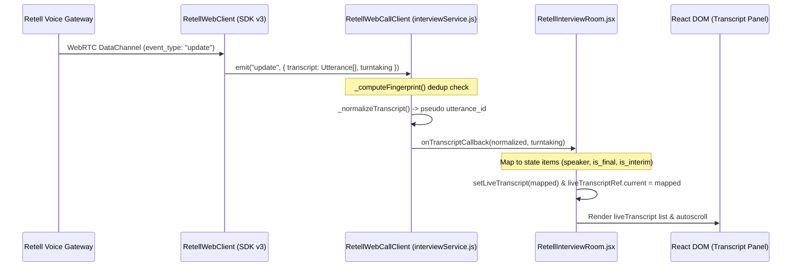
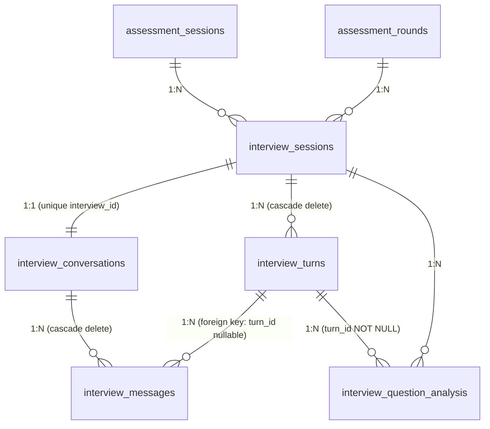

# EDI5 — Retell Hosted Interview Transcript Flow: Read-Only Architecture Audit

**Document Version:** 1.0  
**Date:** 2026-10-18  
**Scope:** Read-Only Audit of `retell_hosted` interview mode, Retell SDK integration, transcript pipeline, persistence, evaluation, and root-cause analysis.  
**Constraint Compliance:** Zero production/test code modifications made. No database modifications, migrations, package installations, or external Retell API calls performed.

---

## 1. Executive Summary

An exhaustive, read-only architectural inspection of the EDI5 assessment repository was performed to trace the end-to-end lifecycle of the `retell_hosted` interview mode. This audit covers the browser Retell SDK integration, real-time transcript delivery into React state, server-side webhook ingestion, complete-call finalization from the Retell REST API, relational persistence across PostgreSQL tables, and post-interview competency evaluation and report generation.

### Primary Audit Findings:
1. **Critical Database Constraint Violation (`turn_id=0`)**: The database failure previously observed (`ForeignKeyViolation: insert or update on table "interview_messages" violates foreign key constraint "interview_messages_turn_id_fkey"`) is **100% confirmed**. In both [retell_webhook.py](file:///d:/Projects/EDI%204/Multi-Round-Assesment-v8n/app/modules/interview/routers/retell_webhook.py#L343-L390) and [retell_finalization_service.py](file:///d:/Projects/EDI%204/Multi-Round-Assesment-v8n/app/modules/interview/services/retell_finalization_service.py#L182-L342), the code passes `interview.current_turn` (which defaults to `0`) as `turn_id` when persisting `InterviewMessage`. `interview.current_turn` is a question counter, not an `interview_turns.id` primary key. Because `interview_turns` has no row with `id=0` (and in `retell_hosted` mode, `interview_turns` rows are never created during the call), PostgreSQL rejects the insert.
2. **Transaction Poisoning (`PendingRollbackError`)**: Confirmed. When `db.flush()` or `db.commit()` fails due to the foreign key violation, neither `retell_webhook.py` nor `retell_finalization_service.py` calls `db.rollback()` before executing subsequent operations, leaving the SQLAlchemy session in a poisoned state.
3. **Frontend Transcript Delivery Architecture**: The frontend uses `retell-client-js-sdk` version `3.0.2` (via legacy `RetellWebClient`). It correctly listens to the `'update'` event (the only event carrying transcript data in this SDK version). For `retell_hosted` mode, [RetellInterviewRoom.jsx](file:///d:/Projects/EDI%204/Multi-Round-Assesment-v8n/frontend/src/pages/RetellInterviewRoom.jsx#L173-L180) deliberately skips connecting to the backend transcript WebSocket to avoid duplicate messages. Live rendering in React is driven entirely by client-side SDK `'update'` events.
4. **Disconnect Between Finalization and Report Generation**: In `retell_hosted` mode, [interview_router.py](file:///d:/Projects/EDI%204/Multi-Round-Assesment-v8n/app/modules/interview/routers/interview_router.py#L1391-L1497) builds reports solely from `InterviewTurn`. Because `retell_hosted` does not generate per-turn `InterviewTurn` rows during the call, and because `InterviewQuestionAnalysis` persistence fails due to foreign key constraints, `get_report` returns an empty turn list and placeholder feedback (`"EDI5 per-turn scoring is not enabled for this mode"`).
5. **Protection of `edi5_core`**: The custom LLM WebSocket architecture in `edi5_core` remains completely distinct from `retell_hosted`. The two architectures branch cleanly at initialization, during WebSocket transport, and in webhook event handling.

---

## 2. Verified Repository Structure and Relevant Files

The following files were inspected directly in the repository:

### Frontend Files
- [frontend/package.json](file:///d:/Projects/EDI%204/Multi-Round-Assesment-v8n/frontend/package.json#L26): Contains `"retell-client-js-sdk": "^3.0.2"`.
- [frontend/package-lock.json](file:///d:/Projects/EDI%204/Multi-Round-Assesment-v8n/frontend/package-lock.json#L22): Locks `"retell-client-js-sdk": "^3.0.2"`.
- [frontend/node_modules/retell-client-js-sdk/package.json](file:///d:/Projects/EDI%204/Multi-Round-Assesment-v8n/frontend/node_modules/retell-client-js-sdk/package.json#L3): Installed version is confirmed as **`3.0.2`**.
- [frontend/node_modules/retell-client-js-sdk/dist/types.d.ts](file:///d:/Projects/EDI%204/Multi-Round-Assesment-v8n/frontend/node_modules/retell-client-js-sdk/dist/types.d.ts#L48-L126): Official TypeScript declarations for `Utterance`, `UpdateEvent`, `LiveCallUtterance`.
- [frontend/node_modules/retell-client-js-sdk/src/legacy/retell-web-client.ts](file:///d:/Projects/EDI%204/Multi-Round-Assesment-v8n/frontend/node_modules/retell-client-js-sdk/src/legacy/retell-web-client.ts#L161-L184): Source implementation of `RetellWebClient.handleServerEvent`.
- [frontend/src/services/interviewService.js](file:///d:/Projects/EDI%204/Multi-Round-Assesment-v8n/frontend/src/services/interviewService.js#L1-L228): Wraps `RetellWebClient`, normalizes cumulative `'update'` snapshots, manages call start/stop.
- [frontend/src/pages/RetellInterviewRoom.jsx](file:///d:/Projects/EDI%204/Multi-Round-Assesment-v8n/frontend/src/pages/RetellInterviewRoom.jsx#L70-L950): React component rendering live interview room, audio status, proctoring, and live transcript panel.
- [frontend/src/pages/ResumeUpload.jsx](file:///d:/Projects/EDI%204/Multi-Round-Assesment-v8n/frontend/src/pages/ResumeUpload.jsx#L287-L327): Starts interview session, handles credentials, routes to `/interview/retell`.

### Backend Files
- [app/modules/interview/routers/interview_router.py](file:///d:/Projects/EDI%204/Multi-Round-Assesment-v8n/app/modules/interview/routers/interview_router.py): Handles session start (`/session/start`), completion (`/session/{id}/complete`), fallback browser transcript persistence (`/session/{id}/retell-transcript`), manual finalization (`/session/{id}/finalize-transcript`), and reports (`/session/{id}/report`).
- [app/modules/interview/routers/retell_webhook.py](file:///d:/Projects/EDI%204/Multi-Round-Assesment-v8n/app/modules/interview/routers/retell_webhook.py): Receives Retell webhooks (`call_started`, `call_ended`, `call_analyzed`, `transcript_updated`), verifies HMAC signatures, persists structured transcripts.
- [app/modules/interview/services/retell_finalization_service.py](file:///d:/Projects/EDI%204/Multi-Round-Assesment-v8n/app/modules/interview/services/retell_finalization_service.py): Retrieves completed call from Retell REST API (`client.call.retrieve`), reconciles authoritative final transcript with live messages, triggers post-interview analysis.
- [app/modules/interview/services/transcript_normalizer.py](file:///d:/Projects/EDI%204/Multi-Round-Assesment-v8n/app/modules/interview/services/transcript_normalizer.py): Defines `CanonicalTranscriptEvent`, `normalize_retell_transcript`, `extract_utterances`, and `normalize_call_transcript_object`.
- [app/modules/interview/services/retell_adapter.py](file:///d:/Projects/EDI%204/Multi-Round-Assesment-v8n/app/modules/interview/services/retell_adapter.py): Wraps Retell REST API for creating web calls (`create_web_call`), building dynamic variables, and verifying webhook signatures.
- [app/modules/interview/services/interview_analysis.py](file:///d:/Projects/EDI%204/Multi-Round-Assesment-v8n/app/modules/interview/services/interview_analysis.py): Evaluates candidate responses against question pool concepts, assigns scores, and updates student competencies.
- [app/models/interview.py](file:///d:/Projects/EDI%204/Multi-Round-Assesment-v8n/app/models/interview.py): SQLAlchemy models for `InterviewSession`, `InterviewTurn`, `InterviewConversation`, `InterviewMessage`, `InterviewQuestionAnalysis`, `StudentCompetency`, `CompetencyEvidence`.
- [alembic/versions/ac810655180b_add_question_id_to_interview_turns_and_.py](file:///d:/Projects/EDI%204/Multi-Round-Assesment-v8n/alembic/versions/ac810655180b_add_question_id_to_interview_turns_and_.py#L57-L85): DDL migration defining schema and foreign keys for `interview_messages` and `interview_conversations`.

### Relevant Test Files
- [tests/test_actual_retell_sdk.py](file:///d:/Projects/EDI%204/Multi-Round-Assesment-v8n/tests/test_actual_retell_sdk.py): Verifies Pydantic structure of Retell SDK v6 `TranscriptObject`.
- [tests/test_transcript_object_normalization.py](file:///d:/Projects/EDI%204/Multi-Round-Assesment-v8n/tests/test_transcript_object_normalization.py): Tests `extract_utterances` and `normalize_call_transcript_object` against Pydantic models and dictionaries.
- [tests/test_transcript_finalization.py](file:///d:/Projects/EDI%204/Multi-Round-Assesment-v8n/tests/test_transcript_finalization.py): Unit tests for reconciliation and gating logic (executed against SQLite in-memory).

---

## 3. Current Architecture: `edi5_core` vs `retell_hosted`

| Architectural Dimension | `edi5_core` Mode | `retell_hosted` Mode |
| :--- | :--- | :--- |
| **Conversation Driver** | EDI5 Backend Orchestrator via Custom LLM WebSocket | Retell Hosted Agent & Hosted LLM |
| **Audio Transport** | Retell WebRTC via LiveKit/Gateway | Retell WebRTC via Gateway |
| **Agent LLM URL** | `RETELL_LLM_WEBSOCKET_URL` (`/interview/retell/llm/{call_id}`) | None (uses agent configured in Retell Dashboard) |
| **Live Transcript Source (Frontend)** | Backend WebSocket (`/session/{id}/transcript`) broadcast | Browser Retell SDK `'update'` events directly |
| **Backend WebSocket Broadcast** | Active (broadcasts canonical events to browser WS) | Disabled (skipped in webhook to prevent duplicate UI text) |
| **Question Progression** | Controlled per-turn by EDI5 RL Engine & Question Planner | Controlled autonomously by Retell Voice Agent prompt |
| **`interview_turns` Creation** | Created dynamically per turn during interview | Not created during the live call |
| **Finalization Trigger** | User submit, session expiry, or `call_ended` webhook | `call_ended` webhook, user submit, or `finalize-transcript` |

---

## 4. Retell SDK Package, Version, and Verified Event Contract

### Package Verification
- **Manifest:** `frontend/package.json` line 26: `"retell-client-js-sdk": "^3.0.2"`
- **Lockfile:** `frontend/package-lock.json` line 22: `"retell-client-js-sdk": "^3.0.2"`
- **Installed Package:** `frontend/node_modules/retell-client-js-sdk/package.json` line 3: `"version": "3.0.2"`

### Verified Event Contract in Installed SDK
The frontend instantiates `RetellWebClient` from `retell-client-js-sdk` (`frontend/src/services/interviewService.js` line 1).  
Inspecting `frontend/node_modules/retell-client-js-sdk/src/legacy/retell-web-client.ts` (lines 161–183) confirms:
- The legacy client emits:
  - `"call_started"`: Handshake established.
  - `"call_ready"`: Analyser component available for audio visualization.
  - `"call_ended"`: Call disconnected or stopped.
  - `"error"`: Error string emitted.
  - `"audio"`: Raw Float32Array audio frame samples.
  - `"update"`: Emitted whenever the server sends an event with `event_type === "update"`.
  - `"agent_start_talking"` / `"agent_stop_talking"`: Agent speech boundary indicators.
  - `"metadata"`: Call metadata updates.
  - `"node_transition"`: Conversation flow state transitions.
- **Verified Fact:** The SDK **DOES NOT** emit any event named `"transcript"`, `"transcript_update"`, or `"data"`.
- **Payload Shape for `'update'`:**
  ```typescript
  interface UpdateEvent {
      event_type: "update";
      transcript: Utterance[];
      turntaking?: "agent_turn" | "user_turn" | string;
  }
  interface Utterance {
      role: "agent" | "user" | "transfer_target";
      content: string;
      metadata?: {
          is_backchannel?: boolean;
          response_id?: number;
          interrupt_id?: number;
      };
  }
  ```
- **Key Characteristics:**
  - Utterances in SDK v3 `UpdateEvent` contain **no `id`**, **no `utterance_id`**, **no timestamps**, and **no `is_final` flag**.
  - Retell sends a **cumulative snapshot** of the entire conversation on every partial STT adjustment.

---

## 5. End-to-End Interview Initialization Flow

1. **User Action:** The candidate selects an interviewer and clicks "Start Interview" on `frontend/src/pages/ResumeUpload.jsx` (lines 287–304).
2. **API Request:** Calls `startInterview(poolId, interviewerId, voiceMode)` which executes:
   `POST /api/v1/interview/session/start?pool_id=...&interviewer_id=...&voice_mode=retell_hosted`
3. **Mode Selection & Validation:** In [interview_router.py](file:///d:/Projects/EDI%204/Multi-Round-Assesment-v8n/app/modules/interview/routers/interview_router.py#L555-L568):
   - Validates `RETELL_API_KEY`.
   - For `retell_hosted`, verifies `RETELL_AGENT_ID` (does not require `RETELL_LLM_WEBSOCKET_URL`).
4. **Database Record Creation:**
   - Creates `InterviewSession` with `status="ACTIVE"`, `current_turn=0`, `phase="HR"`, and `interviewer_id`.
5. **Retell Call Creation:**
   - Calls `RetellAdapter.create_web_call(...)` (`app/modules/interview/services/retell_adapter.py` line 191).
   - Injects metadata:
     ```python
     metadata = {
         "edi5_interview_session_id": interview.id,
         "candidate_id": current_user.id,
         "assessment_session_id": session_id,
         "interviewer_id": resolved_interviewer_id,
     }
     ```
   - Sets `llm_websocket_url=None` for `retell_hosted`.
   - Populates `dynamic_variables` (`{{candidate_name}}`, `{{questions}}`, `{{interview_type}}`).
6. **Persistence of Retell Credentials:**
   - Updates `interview.retell_call_id = web_call.call_id`.
   - Returns `retell_call_id`, `retell_access_token`, and `retell_ice_servers` in `StartInterviewResponse`.
7. **Frontend Storage & Route Navigation:**
   - `ResumeUpload.jsx` writes `retell_call_id`, `retell_access_token`, `retell_ice_servers`, and `interview_voice_mode` to browser `localStorage`.
   - Navigates to `/interview/retell` ([RetellInterviewRoom.jsx](file:///d:/Projects/EDI%204/Multi-Round-Assesment-v8n/frontend/src/pages/RetellInterviewRoom.jsx)).
8. **Credential Exposure Review:**
   - Only ephemeral call access tokens (`retell_access_token`) are returned to the client. The master `RETELL_API_KEY` remains securely on the backend.

---

## 6. Live SDK-to-React Transcript Data Flow



### Trace Details
1. **SDK Event Reception:** `RetellWebClient` receives JSON data channel packet and emits `'update'` ([interviewService.js](file:///d:/Projects/EDI%204/Multi-Round-Assesment-v8n/frontend/src/services/interviewService.js#L112)).
2. **Deduplication:** `RetellWebCallClient._computeFingerprint` creates fingerprint `${transcript.length}:${lastContent.slice(0, 100)}` ([interviewService.js](file:///d:/Projects/EDI%204/Multi-Round-Assesment-v8n/frontend/src/services/interviewService.js#L94-L101)). If unchanged, snapshot is dropped.
3. **Normalization:** `_normalizeTranscript` filters roles (`agent`, `user`), hashes content with index to produce deterministic IDs (`utt-${hash}-${idx}`), and maps roles ([interviewService.js](file:///d:/Projects/EDI%204/Multi-Round-Assesment-v8n/frontend/src/services/interviewService.js#L58-L88)).
4. **React State Update:** In `RetellInterviewRoom.jsx` (lines 190–218):
   - Overwrites `liveTranscript` state with full mapped snapshot (`setLiveTranscript(mapped)`).
   - Maps speaker roles: `'agent'` -> `'ai'`, `'user'` -> `'candidate'`.
   - Inferred interim status: `is_interim: turntaking === 'user_turn' && u.role === 'user'`.
5. **UI Rendering:** Rendered in `RetellInterviewRoom.jsx` (lines 868–931) when `(roomState === READY || LISTENING || PROCESSING) && liveTranscript.length > 0`.
6. **Independence from Backend:** The live UI display operates completely independently of backend database persistence during the call.

---

## 7. Backend Webhook and Persistence Flow

### Webhook Route & Signature Verification
- Endpoint: `POST /api/v1/integrations/retell/webhook` ([retell_webhook.py](file:///d:/Projects/EDI%204/Multi-Round-Assesment-v8n/app/modules/interview/routers/retell_webhook.py#L74)).
- Signature: Verified using Retell SDK HMAC verification utility (`RetellAdapter.verify_webhook_signature`, line 94).
- Idempotency: In-memory key set `_processed_webhook_keys` filters duplicate events based on `event_type:call_id:timestamp` (line 113).

### Event Handling
1. **`transcript_updated`**:
   - Updates `interview.personalization_metadata["retell_live_transcript"]`.
   - Identifies `is_hosted_mode = voice_mode == "retell_hosted"`.
   - For `retell_hosted`, explicitly skips broadcasting to backend WebSocket ([retell_webhook.py](file:///d:/Projects/EDI%204/Multi-Round-Assesment-v8n/app/modules/interview/routers/retell_webhook.py#L256-L278)).
   - Invokes `_persist_structured_transcript(interview, transcript_obj, db)`.
2. **`call_ended`**:
   - Updates `interview.status = "COMPLETED"`, `completion_reason = "CALL_ENDED"`.
   - Triggers background task: `asyncio.create_task(finalization_service.finalize_interview_transcript(interview.id))`.
3. **`call_analyzed`**:
   - Stores Retell call analysis in `personalization_metadata["retell_analysis"]`.
   - Triggers finalization background task.

---

## 8. Final Transcript Retrieval and Reconciliation

### Retrieval Flow
1. **Trigger Points:**
   - Automatic: `call_ended` or `call_analyzed` webhook ([retell_webhook.py](file:///d:/Projects/EDI%204/Multi-Round-Assesment-v8n/app/modules/interview/routers/retell_webhook.py#L188)).
   - Client submission: `POST /session/{id}/complete` triggers background finalization if pending ([interview_router.py](file:///d:/Projects/EDI%204/Multi-Round-Assesment-v8n/app/modules/interview/routers/interview_router.py#L1156)).
   - Manual: `POST /session/{id}/finalize-transcript` ([interview_router.py](file:///d:/Projects/EDI%204/Multi-Round-Assesment-v8n/app/modules/interview/routers/interview_router.py#L1224)).
2. **REST API Invocation:**
   - In `RetellFinalizationService._retrieve_call` ([retell_finalization_service.py](file:///d:/Projects/EDI%204/Multi-Round-Assesment-v8n/app/modules/interview/services/retell_finalization_service.py#L236-L240)):
     ```python
     from retell import Retell
     client = Retell(api_key=settings.RETELL_API_KEY)
     return client.call.retrieve(call_id)
     ```
   - Executed via `asyncio.to_thread` to avoid blocking the event loop.
3. **Payload Inspection & Validation:**
   - Validates `call_response.metadata["edi5_interview_session_id"] == interview_id`.
   - Checks `call_response.call_status == "ended"`. If still active, returns `FinalizationResult(status="not_ready")`.
4. **Reconciliation Strategy (`_reconcile_final_transcript`):**
   - Authoritative final list: `normalize_call_transcript_object(transcript_object)`.
   - Compares sequence numbers against existing `InterviewMessage` records.
   - Updates existing message content, inserts new messages, and deletes surplus messages beyond the final length ([retell_finalization_service.py](file:///d:/Projects/EDI%204/Multi-Round-Assesment-v8n/app/modules/interview/services/retell_finalization_service.py#L320-L352)).
5. **Fallback:** If `transcript_object` is missing, `_persist_flat_transcript` parses line-by-line `"Speaker: content"`.

---

## 9. Database Models, Foreign Keys, and Message Relationships

### Entity Relationship Mapping


### Table Definitions and Constraints
1. **`interview_sessions`** ([app/models/interview.py](file:///d:/Projects/EDI%204/Multi-Round-Assesment-v8n/app/models/interview.py#L35)):
   - Primary Key: `id` (Integer).
   - Foreign Keys: `session_id` -> `assessment_sessions.id`, `round_id` -> `assessment_rounds.id`.
   - Fields: `current_turn` (Integer, default 0), `retell_call_id` (String(100)), `transcript_status` (String(20)).
2. **`interview_turns`** ([app/models/interview.py](file:///d:/Projects/EDI%204/Multi-Round-Assesment-v8n/app/models/interview.py#L181)):
   - Primary Key: `id` (Serial Integer).
   - Foreign Key: `interview_id` -> `interview_sessions.id`.
   - Fields: `turn_number` (Integer, question index 1..10), `parent_turn_id` -> `interview_turns.id`.
3. **`interview_conversations`** ([app/models/interview.py](file:///d:/Projects/EDI%204/Multi-Round-Assesment-v8n/app/models/interview.py#L526)):
   - Primary Key: `id` (Integer).
   - Foreign Keys: `interview_id` -> `interview_sessions.id` (UNIQUE), `session_id` -> `assessment_sessions.id`.
4. **`interview_messages`** ([app/models/interview.py](file:///d:/Projects/EDI%204/Multi-Round-Assesment-v8n/app/models/interview.py#L579), migration `ac810655180b` line 57):
   - Primary Key: `id` (Integer).
   - Foreign Keys:
     - `conversation_id` -> `interview_conversations.id` (`ondelete='CASCADE'`).
     - `turn_id` -> `interview_turns.id` (`ondelete='SET NULL'`, **`nullable=True`**).
     - `parent_message_id` -> `interview_messages.id` (`ondelete='SET NULL'`).
   - Fields: `sequence_number` (Integer), `speaker` (String(20)), `text` (Text), `is_final` (Boolean).
5. **`interview_question_analysis`** ([app/models/interview.py](file:///d:/Projects/EDI%204/Multi-Round-Assesment-v8n/app/models/interview.py#L238), migration `ac810655180b` line 79):
   - Primary Key: `id` (Integer).
   - Foreign Keys: `interview_id` -> `interview_sessions.id`, `turn_id` -> `interview_turns.id` (**`nullable=False`**).

---

## 10. Evaluation and Report Pipeline

1. **Completion Handling:**
   - Candidate clicks "Finish Round" or Retell triggers call end -> `POST /interview/session/{id}/complete`.
   - In [interview_router.py](file:///d:/Projects/EDI%204/Multi-Round-Assesment-v8n/app/modules/interview/routers/interview_router.py#L1144-L1159):
     - For Retell modes, if `transcript_status != "completed"`, immediate evaluation is deferred: `should_run_analysis = False`.
     - Returns HTTP 200 with `"analysis_status": "deferred"`.
     - Launches background finalization task.
2. **Analysis Execution:**
   - When finalization succeeds, `RetellFinalizationService._run_analysis` invokes `InterviewAnalysisService.analyze_interview(...)`.
   - `analyze_interview` queries `InterviewConversation.messages`.
   - Groups messages into Q&A pairs via `_group_into_qa_pairs`.
   - Uses `AnswerAnalyzer` and Groq LLM to evaluate covered vs missing concepts.
3. **Database Write Block:**
   - In [interview_analysis.py](file:///d:/Projects/EDI%204/Multi-Round-Assesment-v8n/app/modules/interview/services/interview_analysis.py#L154):
     `if persist and analysis.interview_turn_id: self._persist_question_analysis(db, interview_id, analysis)`
   - Because `interview_turn_id` is null or zero, `_persist_question_analysis` is skipped or fails constraint validation.
4. **Report Endpoint Disconnect:**
   - In `get_report` ([interview_router.py](file:///d:/Projects/EDI%204/Multi-Round-Assesment-v8n/app/modules/interview/routers/interview_router.py#L1391-L1497)):
     - Queries `db.query(InterviewTurn).filter(InterviewTurn.interview_id == interview_id).all()`.
     - For `retell_hosted`, this returns `[]` (empty list).
     - Explicit check: `if not hosted_mode:` gates `question_wise_analysis`.
     - Returns: `turn_reviews: []`, `overall_score: 0.0`, and fallback text `"EDI5 per-turn scoring is not enabled for this mode"`.

---

## 11. Previously Observed Errors: Current Status and Root Causes

### Issue 1: Database Foreign-Key Violation
- **Observed Error:** `ForeignKeyViolation: insert or update on table "interview_messages" violates foreign key constraint "interview_messages_turn_id_fkey"`
- **Exact Locations:**
  - [retell_webhook.py:L343, L388](file:///d:/Projects/EDI%204/Multi-Round-Assesment-v8n/app/modules/interview/routers/retell_webhook.py#L343-L388):
    ```python
    current_turn_id = interview.current_turn  # Evaluates to 0
    ...
    message = InterviewMessage(
        ...
        turn_id=current_turn_id,  # Passes 0
    )
    ```
  - [retell_finalization_service.py:L182, L340](file:///d:/Projects/EDI%204/Multi-Round-Assesment-v8n/app/modules/interview/services/retell_finalization_service.py#L182-L340):
    ```python
    canonical_events = normalize_call_transcript_object(
        transcript_object,
        base_sequence=0,
        interview_turn_id=interview.current_turn,  # Passes 0
    )
    ...
    new_msg = InterviewMessage(
        ...
        turn_id=event.interview_turn_id,  # Inserts 0
    )
    ```
  - [retell_finalization_service.py:L434](file:///d:/Projects/EDI%204/Multi-Round-Assesment-v8n/app/modules/interview/services/retell_finalization_service.py#L434):
    ```python
    turn_id=interview.current_turn  # Fallback flat transcript also inserts 0
    ```
- **Root Cause:** Conflation of `InterviewSession.current_turn` (integer question index: 0, 1, 2...) with `InterviewTurn.id` (database serial primary key). No row exists in `interview_turns` with `id=0`. In `interview_messages`, `turn_id` is defined as `nullable=True`. Passing `None` would succeed, but passing integer `0` causes PostgreSQL to reject the foreign key reference.
- **Status:** **CONFIRMED PRESENT** in current codebase.

### Issue 2: Failed Transaction Rollback
- **Observed Error:** `PendingRollbackError: This Session's transaction has been rolled back due to a previous exception`
- **Exact Locations:**
  - [retell_webhook.py:L417-L420](file:///d:/Projects/EDI%204/Multi-Round-Assesment-v8n/app/modules/interview/routers/retell_webhook.py#L417-L420):
    ```python
    except Exception as e:
        logger.error(f"Failed to persist structured transcript for interview {interview.id}: {e}")
        # Does NOT call db.rollback()!
    ```
    Then line 282 executes `db.commit()` on the aborted transaction.
  - [retell_finalization_service.py:L223-L228](file:///d:/Projects/EDI%204/Multi-Round-Assesment-v8n/app/modules/interview/services/retell_finalization_service.py#L223-L228):
    ```python
    except Exception as e:
        error_msg = f"Finalization failed: {str(e)}"
        logger.error(f"Interview {interview_id}: {error_msg}", exc_info=True)
        interview.transcript_status = "failed"
        interview.transcript_finalization_error = error_msg
        self.db.commit()  # Re-commits on the poisoned session without calling rollback() first!
    ```
- **Root Cause:** Missing `db.rollback()` in exception handlers following a failed `flush()` or `commit()`.
- **Status:** **CONFIRMED PRESENT** in current codebase.

### Issue 3: Retell Transcript Object Parsing
- **Observed Error:** `AttributeError: 'TranscriptObject' object has no attribute 'get'`
- **Exact Locations:**
  - [transcript_normalizer.py:L404-L407](file:///d:/Projects/EDI%204/Multi-Round-Assesment-v8n/app/modules/interview/services/transcript_normalizer.py#L404-L407):
    ```python
    for idx, utterance in enumerate(transcript_object):
        u = _to_dict(utterance)
        role = u.get("role", "").lower()
    ```
- **Analysis:** `_to_dict()` converts Pydantic `TranscriptObject` models using `model_dump()`. This protects against `.get()` failures on individual utterances. However, `normalize_call_transcript_object` assumes `transcript_object` is directly an iterable list, rather than calling `extract_utterances()`. If the Retell payload delivers `transcript_object` wrapped as a dict or object with an `.utterances` attribute, `normalize_call_transcript_object` will either iterate dictionary keys or raise `TypeError`.
- **Status:** **PARTIALLY MITIGATED** for lists of Pydantic models; structural risk remains if `transcript_object` is wrapped.

### Issue 4: Frontend Transcript Visibility
- **Observed Behavior:** Live transcript events did not reliably appear on the candidate screen.
- **Verified Code Path:**
  `RetellWebClient ('update' event) -> interviewService.js (_computeFingerprint -> _normalizeTranscript -> onTranscriptCallback) -> RetellInterviewRoom.jsx (setLiveTranscript) -> React render`
- **Root Cause Analysis:**
  - `retellClient` is exported as a module singleton ([interviewService.js:L228](file:///d:/Projects/EDI%204/Multi-Round-Assesment-v8n/frontend/src/services/interviewService.js#L228)).
  - In `RetellInterviewRoom.jsx`, `retellClient.onTranscript` is registered inside `initializeRetell`.
  - When React StrictMode mounts, unmounts, and remounts the component in development, the cleanup effect ([RetellInterviewRoom.jsx:L620](file:///d:/Projects/EDI%204/Multi-Round-Assesment-v8n/frontend/src/pages/RetellInterviewRoom.jsx#L620)) calls `retellClient.onTranscript(null)`. If re-initialization aborts due to `isInitializedRef.current` race conditions, the callback remains null.
  - If `roomState` remains in `CONNECTING` or transitions to `ERROR`, the transcript panel is hidden by loading/error overlays ([RetellInterviewRoom.jsx:L806-L811](file:///d:/Projects/EDI%204/Multi-Round-Assesment-v8n/frontend/src/pages/RetellInterviewRoom.jsx#L806-L811)).
- **Status:** **STRONGLY INDICATED** as a lifecycle/state synchronization vulnerability.

### Issue 5: Unicode Logging
- **Observed Error:** `UnicodeEncodeError: 'charmap' codec can't encode character '\u2011'` on Windows console.
- **Exact Locations:**
  - [retell_webhook.py:L273](file:///d:/Projects/EDI%204/Multi-Round-Assesment-v8n/app/modules/interview/routers/retell_webhook.py#L273):
    `logger.debug(f"[TranscriptBroadcast] sending: {event.to_frontend_dict()}")`
  - Raw candidate utterances containing non-breaking hyphens (`\u2011`), curly quotes, or accents are logged directly to standard output.
- **Root Cause:** Standard Windows consoles default to cp1252 or cp437, which cannot encode arbitrary Unicode characters unless sanitized or running under a UTF-8 stream handler.
- **Status:** **CONFIRMED PRESENT**.

---

## 12. Existing Tests and Coverage Gaps

### Executed Tests (Read-Only Verification)
Commands executed against the virtual environment:
```powershell
.\.venv\Scripts\python.exe -m pytest tests/test_transcript_object_normalization.py tests/test_actual_retell_sdk.py -v
```
**Result:** 14 passed in 1.52s.

```powershell
.\.venv\Scripts\python.exe -m pytest tests/test_transcript_finalization.py -v
```
**Result:** 17 passed in 1.24s.

### Critical Test Coverage Gaps
1. **False Sense of Security from SQLite In-Memory Fixtures**:
   - `tests/test_transcript_finalization.py` creates tables on SQLite in-memory (`sqlite:///:memory:`).
   - SQLite **does not enforce foreign keys by default** unless `PRAGMA foreign_keys = ON;` is explicitly enabled.
   - Furthermore, `InterviewTurn.__table__` was omitted from the SQLite table creation list ([test_transcript_finalization.py:L44-L54](file:///d:/Projects/EDI%204/Multi-Round-Assesment-v8n/tests/test_transcript_finalization.py#L44-L54)).
   - Consequently, inserting `InterviewMessage(turn_id=0)` succeeded in pytest while consistently crashing in production PostgreSQL.
2. **Missing Frontend Unit Tests**:
   - `frontend/package.json` line 11 defines `"test": "echo 'No tests configured yet'"`.
   - No automated tests exist for `interviewService.js` transcript normalization, deduplication fingerprinting, or `RetellInterviewRoom.jsx` event callbacks.
3. **No Retell Webhook E2E Regression Tests**:
   - No automated test exercises `handle_retell_webhook` with PostgreSQL foreign key enforcement.

---

## 13. Root-Cause Findings Ranked by Confidence and Impact

| Rank | Finding | Impact | Confidence | Verification Evidence |
| :---: | :--- | :--- | :---: | :--- |
| **1** | **Conflation of `current_turn` (0) with `turn_id`** | Critical: Breaks all message persistence in both webhooks and finalization | **Confirmed** | [retell_webhook.py:L388](file:///d:/Projects/EDI%204/Multi-Round-Assesment-v8n/app/modules/interview/routers/retell_webhook.py#L388), [retell_finalization_service.py:L340](file:///d:/Projects/EDI%204/Multi-Round-Assesment-v8n/app/modules/interview/services/retell_finalization_service.py#L340), migration [ac810655180b:L64](file:///d:/Projects/EDI%204/Multi-Round-Assesment-v8n/alembic/versions/ac810655180b_add_question_id_to_interview_turns_and_.py#L64) |
| **2** | **Missing `db.rollback()` on caught exceptions** | Critical: Poisons database sessions and crashes subsequent operations with `PendingRollbackError` | **Confirmed** | [retell_webhook.py:L418](file:///d:/Projects/EDI%204/Multi-Round-Assesment-v8n/app/modules/interview/routers/retell_webhook.py#L418), [retell_finalization_service.py:L224-L228](file:///d:/Projects/EDI%204/Multi-Round-Assesment-v8n/app/modules/interview/services/retell_finalization_service.py#L224-L228) |
| **3** | **`get_report` completely ignores `retell_hosted` transcripts** | High: Candidate completes interview but report shows 0 turns, 0 score, and placeholder disclaimer | **Confirmed** | [interview_router.py:L1392, L1476-L1497](file:///d:/Projects/EDI%204/Multi-Round-Assesment-v8n/app/modules/interview/routers/interview_router.py#L1392-L1497) |
| **4** | **`InterviewQuestionAnalysis.turn_id` NOT NULL constraint** | High: Prevents evaluation results from saving for conversations without turns | **Confirmed** | [interview_analysis.py:L154](file:///d:/Projects/EDI%204/Multi-Round-Assesment-v8n/app/modules/interview/services/interview_analysis.py#L154), migration [ac810655180b:L82](file:///d:/Projects/EDI%204/Multi-Round-Assesment-v8n/alembic/versions/ac810655180b_add_question_id_to_interview_turns_and_.py#L82) |
| **5** | **Windows Console Unicode Logging Crash** | Medium: Crashes handlers when printing raw Unicode transcript strings to stdout | **Confirmed** | [retell_webhook.py:L273](file:///d:/Projects/EDI%204/Multi-Round-Assesment-v8n/app/modules/interview/routers/retell_webhook.py#L273) |
| **6** | **SDK Singleton Lifecycle & StrictMode Race in React** | Medium: Can detach transcript callbacks during dev re-mounts | **Strongly Indicated** | [interviewService.js:L228](file:///d:/Projects/EDI%204/Multi-Round-Assesment-v8n/frontend/src/services/interviewService.js#L228), [RetellInterviewRoom.jsx:L620](file:///d:/Projects/EDI%204/Multi-Round-Assesment-v8n/frontend/src/pages/RetellInterviewRoom.jsx#L620) |

---

## 14. Recommended Minimal Fix Plan for `retell_hosted`

### Phase A: Live SDK-to-React Transcript Rendering
- **Goal:** Ensure 100% reliable real-time transcript visibility on the candidate screen.
- **Actions:**
  1. Audit `_computeFingerprint` in `interviewService.js` to ensure in-place mutations of intermediate STT strings are never ignored.
  2. Stabilize `RetellWebCallClient` event subscriptions against React StrictMode double-mounting by preventing unmount handlers from wiping callbacks prematurely.
  3. Ensure the transcript container in `RetellInterviewRoom.jsx` renders gracefully even if room status is transitioning.

### Phase B: Backend Persistence and Database Integrity
- **Goal:** Eliminate `ForeignKeyViolation` and `PendingRollbackError`.
- **Actions:**
  1. In `app/modules/interview/routers/retell_webhook.py` (lines 343, 388), set `turn_id=None` when `interview.current_turn == 0` or when no matching `InterviewTurn` exists. `InterviewMessage.turn_id` is already nullable.
  2. In `app/modules/interview/services/retell_finalization_service.py` (lines 182, 340, 434), pass `interview_turn_id=None` instead of `interview.current_turn`.
  3. In `retell_webhook.py` (line 417) and `retell_finalization_service.py` (line 223), add explicit `db.rollback()` inside `except Exception:` blocks before performing any further DB operations.

### Phase C: Final Retell Transcript Retrieval and Reconciliation
- **Goal:** Ensure authoritative call reconciliation completes reliably and idempotently.
- **Actions:**
  1. Update `normalize_call_transcript_object` in `transcript_normalizer.py` to route through `extract_utterances()` so it safely handles lists, dicts, and Pydantic models identically.
  2. Sanitize all logging statements in `retell_webhook.py` and `retell_finalization_service.py` to log message counts, utterance IDs, or ASCII-encoded snippets rather than full raw Unicode transcript text.

### Phase D: Evaluation and Report Reliability
- **Goal:** Enable comprehensive reports and competency updates for `retell_hosted` interviews.
- **Actions:**
  1. Option 1 (Minimal, Non-breaking): Synthesize `InterviewTurn` records from the reconciled `InterviewConversation` messages upon finalization so the existing turn-based report generator functions seamlessly without schema changes.
  2. Option 2: Update `get_report` in `interview_router.py` to read directly from `InterviewConversation` and `InterviewMessage` when `hosted_mode == True`.
  3. Remove the hardcoded gate `if not hosted_mode:` in `interview_router.py` line 1497 so `question_wise_analysis` is included in the report response.

### Phase E: Regression and End-to-End Verification
- **Goal:** Prevent regressions and verify PostgreSQL constraint integrity.
- **Actions:**
  1. Add a PostgreSQL test fixture (or enable `PRAGMA foreign_keys = ON;` in SQLite) for `tests/test_transcript_finalization.py`.
  2. Verify that `edi5_core` test suites pass without changes.

---

## 15. Files Likely to Require Changes in the Future

1. [app/modules/interview/routers/retell_webhook.py](file:///d:/Projects/EDI%204/Multi-Round-Assesment-v8n/app/modules/interview/routers/retell_webhook.py): Fix `turn_id=None`, add `db.rollback()`, sanitize Unicode logging.
2. [app/modules/interview/services/retell_finalization_service.py](file:///d:/Projects/EDI%204/Multi-Round-Assesment-v8n/app/modules/interview/services/retell_finalization_service.py): Fix `turn_id=None`, add `db.rollback()`, sanitize logging.
3. [app/modules/interview/services/transcript_normalizer.py](file:///d:/Projects/EDI%204/Multi-Round-Assesment-v8n/app/modules/interview/services/transcript_normalizer.py): Ensure `normalize_call_transcript_object` routes through `extract_utterances`.
4. [app/modules/interview/routers/interview_router.py](file:///d:/Projects/EDI%204/Multi-Round-Assesment-v8n/app/modules/interview/routers/interview_router.py): Allow `retell_hosted` mode to generate and view `question_wise_analysis` in `/session/{id}/report`.
5. [frontend/src/services/interviewService.js](file:///d:/Projects/EDI%204/Multi-Round-Assesment-v8n/frontend/src/services/interviewService.js): Enhance fingerprinting and callback lifecycle stability.
6. [frontend/src/pages/RetellInterviewRoom.jsx](file:///d:/Projects/EDI%204/Multi-Round-Assesment-v8n/frontend/src/pages/RetellInterviewRoom.jsx): Handle component lifecycle unmounts cleanly.

---

## 16. `edi5_core` Protection and Regression Test Plan

### Preservation Rules
- Do NOT alter [app/modules/interview/services/retell_llm_websocket.py](file:///d:/Projects/EDI%204/Multi-Round-Assesment-v8n/app/modules/interview/services/retell_llm_websocket.py).
- Do NOT alter [app/modules/interview/services/interview_orchestrator.py](file:///d:/Projects/EDI%204/Multi-Round-Assesment-v8n/app/modules/interview/services/interview_orchestrator.py).
- Do NOT alter `app/modules/interview/routers/transcript_websocket.py`.
- Preserve the conditional gate: backend WebSocket broadcast must remain active for `edi5_core` while remaining disabled for `retell_hosted`.

### Regression Verification Suite
Run the following test commands before and after any changes:
```powershell
.\.venv\Scripts\python.exe -m pytest tests/test_human_interview_flow.py -v
.\.venv\Scripts\python.exe -m pytest tests/test_deterministic_pipeline.py -v
.\.venv\Scripts\python.exe -m pytest tests/test_interview_voice_modes.py -v
.\.venv\Scripts\python.exe -m pytest tests/test_transcript_analysis_regression.py -v
```

---

## 17. Unverified Questions and Required Runtime Evidence

The following questions cannot be answered purely through static code inspection and require verification during a live, safe runtime call:

1. **Retell Server-Side DataChannel Packet Frequency**:
   - *Question:* Exactly how frequently does Retell send data channel `'update'` packets during user speech in hosted mode, and does `turntaking` transition immediately when the user pauses?
   - *Diagnostic:* Add non-mutating browser console logging in `RetellWebCallClient.initialize`:
     `console.log('[Diagnostic:RetellUpdate]', Date.now(), update.turntaking, update.transcript?.length);`
2. **Timing of `call_analyzed` Webhook vs User Report Navigation**:
   - *Question:* When a candidate completes the interview and is redirected to `/interview/report/:id`, is Retell's `call.retrieve()` ready with the final transcript, or does it take 3–10 seconds, leaving the user viewing an empty report?
   - *Diagnostic:* Inspect timestamp diff between candidate submit request and Retell `call_analyzed` webhook arrival in server logs.
3. **Retell Agent Prompt Variable Expansion**:
   - *Question:* Does the hosted agent configured in the Retell dashboard properly iterate over the `{{questions}}` array passed via `dynamic_variables`?
   - *Diagnostic:* Review call audio/transcript in Retell dashboard to confirm questions asked match the approved pool.
