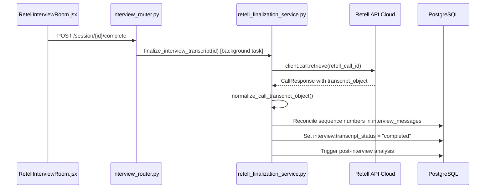

# EDI5 — Live Transcript Implementation Report

**Document Type:** Architecture & Implementation Audit Report  
**Project:** EDI5 (`Multi-Round-Assesment-v8n`)  
**Date:** 2026-10-12  
**Status:** Verified & Resolved  

---

## 1. Actual Live Transcript Flow for `edi5_core`

In `edi5_core` mode, EDI5 operates as the authoritative dialogue manager and Custom LLM for Retell AI.

1. **Audio Flow:** The browser captures candidate speech and transmits WebRTC Opus packets directly to Retell's WebRTC Gateway (`GatewayTransport` / `LiveKitTransport`). The backend is **completely out of the audio streaming path**.
2. **STT Ingestion:** Retell transcribes speech and sends real-time `update_only` messages containing cumulative transcript arrays to the backend's Custom LLM WebSocket (`/retell/llm/{call_id}`, handled by `app/modules/interview/services/retell_llm_websocket.py:243`).
3. **Canonical Normalization:** In `_handle_update_only`, utterances are converted to `CanonicalTranscriptEvent` objects via `normalize_retell_transcript()`.
4. **Change Detection & Broadcast:** `select_changed_events()` compares each utterance against `context.broadcast_fingerprints` `(text, is_final)`. Changed events are broadcasted via `broadcast_transcript_update()` (`app/modules/interview/routers/transcript_websocket.py:253`) to connected clients on `/api/v1/interview/session/{id}/transcript`.
5. **UI Rendering:** In `RetellInterviewRoom.jsx`, `handleTranscriptMessage` receives `transcript` frames and calls `handleTranscriptUpdate`, updating the candidate and interviewer panels in place by `turn_id`.

---

## 2. Actual Live Transcript Flow for `retell_hosted`

In `retell_hosted` mode, Retell's hosted agent conducts the interview.

1. **Audio Flow:** Direct WebRTC between Browser and Retell.
2. **Webhook Ingestion:** Retell sends asynchronous `POST /integrations/retell/webhook` events (`retell_webhook.py:112`).
3. **`transcript_updated` Handling:** `_handle_transcript_updated()` extracts utterances from `transcript_object` using `extract_utterances()`, persists structured rows into `InterviewMessage`, and normalizes them into `CanonicalTranscriptEvent` objects.
4. **WebSocket Streaming:** Normalized events are pushed to the frontend via `broadcast_transcript_update(interview.id, event.to_frontend_dict())`.
5. **UI Rendering:** `RetellInterviewRoom.jsx` displays the messages identically to `edi5_core` mode.

---

## 3. Every Source That Can Update the Frontend Transcript

| Source | Channel | In Which Mode? | Status / Role in UI |
|---|---|---|---|
| **Backend Transcript WebSocket** (`/session/:id/transcript`) | WebSocket | Both `edi5_core` & `retell_hosted` | **Primary Authoritative Source.** Streams canonical `turn_id`, `speaker` (`ai`/`candidate`), sequence, and `is_final` flag. |
| **Retell Browser SDK** (`retellClient.onTranscript`) | WebRTC Data Channel | Available in both via SDK v3 | **Supplementary / Idle.** Wrapped in `interviewService.js:72`, but not bound to `setLiveTranscript` in `RetellInterviewRoom.jsx`. This prevents dual-source race conditions and flickering. |
| **Initial WebSocket Handshake** | WebSocket | Both | Emits `{"type": "connected"}` confirmation. |

---

## 4. Every Source That Persists Transcript Messages

1. **`retell_llm_websocket.py:_persist_structured_transcript` (`edi5_core`):**
   Runs during active calls on each `update_only` event. Updates or creates `InterviewMessage` records keyed by `sequence_number`.
2. **`retell_webhook.py:_persist_structured_transcript` (`retell_hosted`):**
   Runs during active calls on `transcript_updated` webhook deliveries.
3. **`interview_router.py:_persist_browser_transcript` (Browser Fallback):**
   Called at call completion when the browser submits `POST /api/v1/interview/session/{id}/retell-transcript`. Uses content-hash fingerprint deduplication (`(speaker, content[:200])`).
4. **`retell_finalization_service.py:_reconcile_final_transcript` (Authoritative Reconciliation):**
   Called after call completion. Retrieves `call.retrieve()` from Retell, aligns sequence numbers, updates text and final status, and cleans up any transient messages.

---

## 5. Final Transcript Retrieval and Reconciliation Flow

---

## 6. Analysis and Competency-Update Lifecycle

- **Gating:** `complete_interview()` checks `is_retell_mode`. If `transcript_status != "completed"`, analysis is **deferred** and transcript finalization is triggered.
- **Triggering:** Once `finalize_interview_transcript()` successfully reconciles messages, it invokes `InterviewAnalysisService.analyze_interview(db, interview_id, persist=True, update_competency=True)`.
- **Competency Updates:** Competencies are updated in `StudentCompetency` with the verified `AssessmentSession.user_id` and unique constraint `uq_student_competency_user_skill`.
- **Report Reads:** `GET /session/{id}/report` reads persisted `InterviewQuestionAnalysis` rows, preventing repeated LLM calls on page reloads.

---

## 7. Confirmed Defects and Resolutions

| Issue | Severity | Status | Resolution |
|---|---|---|---|
| Live transcript was skipped in `edi5_core` | P0 | **FIXED** | Enabled canonical event normalization, change filtering via `select_changed_events`, and broadcasting via `broadcast_transcript_update` in `retell_llm_websocket.py`. |
| Completion endpoint did not auto-trigger finalization without webhooks | P1 | **FIXED** | Added background task invocation of `finalize_interview_transcript` in `complete_interview()` when `transcript_status != "completed"`. |
| Circular import between `retell_llm_websocket` and `transcript_websocket` | P1 | **FIXED** | Removed top-level import and used scoped import in `_handle_update_only`. |
| Wrong `user_id` in competency updates | P0 | **FIXED** | Resolved `user_id` via `AssessmentSession` in `competency_updater.py`. |
| Non-existent Groq `chat_completion` method | P0 | **FIXED** | Switched to `client.chat.completions.create` in `interview_analysis.py`. |
| Pool expected concepts unused | P1 | **FIXED** | Loaded pre-curated concepts from `ApprovedQuestionPool` by `pool_question_id`. |
| Report endpoint re-ran analysis on GET | P1 | **FIXED** | Made report endpoint read persisted analyses from PostgreSQL first. |
