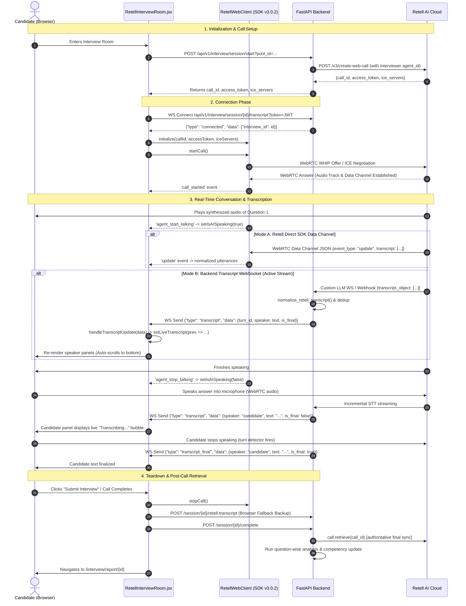

# Working Retell Live Transcript Architecture Audit: Frontend, Backend, and Retell SDK

**Document Type:** Read-Only Architectural Audit & Reverse-Engineering Technical Reference  
**Project:** EDI5 (`Multi-Round-Assesment-v8n`)  
**Audit Date:** 2026-10-12  
**Auditor:** Senior Full-Stack Architect  
**Status:** Complete — Source Code & Installed SDK Evidence Verified  
**Scope:** Strictly Read-Only (no application code, schema, or configuration modified)

---

## 1. Executive Summary

This audit performs an end-to-end architectural reverse-engineering of the working live interview transcript system in the EDI5 application. During live voice calls in `RetellInterviewRoom.jsx`, spoken words are captured, transcribed, and displayed dynamically in speaker-separated panels (AI Interviewer vs. Candidate). 

The audit answers the central architectural question: **Where does live transcript text originate, how does it traverse the network, how is it separated by speaker, and what are the respective roles of the frontend, backend, Retell AI, and the database?**

### Key Architectural Findings:

1. **Dual Transport Architecture:**
   The application supports two distinct operational modes:
   - **`edi5_core` (Custom LLM Mode):** Audio streams directly between the candidate's browser and Retell's WebRTC Gateway. Retell connects via a bidirectional Custom LLM WebSocket (`/retell/llm/{call_id}`) to the FastAPI backend. Live transcripts are ingested by the backend from Retell (`update_only` events) and streamed to the frontend via an internal backend WebSocket (`/api/v1/interview/session/{id}/transcript`).
   - **`retell_hosted` (Retell Agent Mode):** Retell controls the dialogue. The frontend receives audio via WebRTC. Retell sends webhook notifications (`transcript_updated`) to the backend, which normalizes utterances and broadcasts them over the backend WebSocket to the frontend.
   - **Browser SDK Direct Channel (SDK Capability):** In both modes, the browser's `RetellWebClient` receives real-time JSON frames directly over the WebRTC data channel (`GatewayTransport` control channel or `LiveKitTransport` data channel) containing `update` events with `update.transcript: Utterance[]`. The EDI5 frontend wraps this in `RetellWebCallClient` in `interviewService.js`.

2. **The Backend's True Role in Live Transcription:**
   - **Live Audio:** The backend is completely **out of the live audio path**. Audio flows strictly `Browser ↔ Retell WebRTC Gateway`.
   - **Live Transcript Delivery:** The live transcript UI in `RetellInterviewRoom.jsx` is fed via the backend's authenticated WebSocket (`/api/v1/interview/session/{id}/transcript`), which provides normalized, sequentially ordered, deduplicated transcript messages with deterministic turn IDs (`turn_id`, `speaker: "ai" | "candidate"`, `text`, `is_final`).
   - **Fallback Browser Persistence:** Upon call completion, the browser acts as a safety fallback, serializing its local in-memory transcript and calling `POST /api/v1/interview/session/{id}/retell-transcript`.

3. **Role of Supabase / Database:**
   - **Supabase is NOT used.** The project runs standard **PostgreSQL** with **SQLAlchemy ORM** and **Alembic migrations**.
   - The database plays **zero role in the live rendering path**. No database reads or writes occur per spoken word or keystroke.
   - Post-call, PostgreSQL stores the structured conversation (`interview_conversations`, `interview_messages`), question-wise semantic evaluation (`interview_question_analysis`), and skill profiles (`student_competencies`).

---

## 2. Repository and SDK Version Information

### 2.1 Frontend Stack
- **Framework:** React `19.2.0` with Vite `7.3.1` (SPA architecture, React Router `7.13.1`)
- **Styling:** TailwindCSS `4.2.1`
- **HTTP Client:** Axios `1.7.9`
- **Icons:** Lucide React `0.577.0`
- **Charts:** Recharts `3.8.1`
- **Location:** `frontend/`

### 2.2 Backend Stack
- **Framework:** FastAPI with Uvicorn `0.x`
- **Language / Runtime:** Python 3.11
- **Database / ORM:** PostgreSQL, SQLAlchemy 2.0 (mapped columns), Alembic
- **LLM / AI Integrations:** Groq SDK (`groq`), Sarvam AI, Retell SDK (`retell-sdk`)
- **Location:** `app/`

### 2.3 Retell SDK Packages
- **Frontend SDK:** `retell-client-js-sdk` version **`3.0.2`** (defined in `frontend/package.json` line 26; installed in `frontend/node_modules/retell-client-js-sdk/`)
- **Backend SDK:** `retell-sdk` (Python, in `requirements.txt` line 24)

---

## 3. Overall Architecture

```
   ┌────────────────────────────────────────────────────────────────────────┐
   │                            CANDIDATE BROWSER                           │
   │                                                                        │
   │   ┌────────────────────────────────────────────────────────────────┐   │
   │   │               RetellInterviewRoom.jsx (React 19)              │   │
   │   │                                                                │   │
   │   │   [AI Interviewer Panel]            [Candidate Panel]          │   │
   │   │   speaker === 'ai'                  speaker === 'candidate'    │   │
   │   └──────────────────────▲─────────────────────────▲───────────────┘   │
   │                          │                         │                   │
   │              WebSocket onmessage             retellClient (SDK)        │
   │                          │                   events: agent_start/stop  │
   │                          │                         │                   │
   │   ┌──────────────────────┴──────────────┐   ┌──────┴───────────────┐   │
   │   │ native WebSocket                    │   │ RetellWebCallClient  │   │
   │   │ /session/:id/transcript             │   │ (interviewService.js)│   │
   │   └──────────────▲──────────────────────┘   └──────▲───────────────┘   │
   └──────────────────┼─────────────────────────────────┼───────────────────┘
                      │                                 │
          WS JSON Stream (live transcript)     WebRTC Media & Control Channel
                      │                                 │
                      ▼                                 ▼
   ┌─────────────────────────────────────┐   ┌──────────────────────────────┐
   │            EDI5 BACKEND             │   │       RETELL AI CLOUD        │
   │          (FastAPI / Python)         │   │                              │
   │                                     │   │  • Voice Synthesis (TTS)     │
   │  • transcript_websocket.py          │   │  • Speech-to-Text (STT)      │
   │    (broadcasts canonical events)    │   │  • Turn Detection            │
   │                                     │   │  • WebRTC Gateway            │
   │  • retell_llm_websocket.py          │   │                              │
   │    (Custom LLM WebSocket server)◄───┼───┼─ Custom LLM WebSocket        │
   │                                     │   │   (edi5_core mode)           │
   │  • retell_webhook.py                │   │                              │
   │    (POST /integrations/retell/      │◄──┼── Webhook Notifications      │
   │     webhook)                        │   │   (retell_hosted mode)       │
   │                                     │   │                              │
   │  • retell_adapter.py                │───┼──► REST API (v3)             │
   │    (POST /v3/create-web-call)       │   │    create-web-call           │
   └──────────────────▲──────────────────┘   └──────────────────────────────┘
                      │
           PostgreSQL Persistence
           (Post-call analysis & reports)
                      │
                      ▼
   ┌─────────────────────────────────────┐
   │             POSTGRESQL              │
   │  • interview_conversations          │
   │  • interview_messages               │
   │  • interview_question_analysis      │
   │  • student_competencies             │
   └─────────────────────────────────────┘
```

---

## 4. End-to-End Live Transcript Sequence Diagram



---

## 5. Exact Retell SDK Initialization and Event Subscription Flow

### 5.1 RetellWebClient Creation and Retention
- **File:** `frontend/src/services/interviewService.js` (lines 24–202)
- **Class:** `RetellWebCallClient` wraps the underlying SDK `RetellWebClient`.
- **Instance Retention:** Created as a module-level singleton:
  ```javascript
  // interviewService.js:202
  export const retellClient = new RetellWebCallClient();
  ```
- **SDK Instantiation:**
  ```javascript
  // interviewService.js:68
  this.client = new RetellWebClient();
  ```
- **Lifecycle in React:** In `RetellInterviewRoom.jsx`, the component accesses `retellClient` directly. The initialization is guarded by `isInitializedRef.current` to ensure it only initializes once per mount.

### 5.2 Underlying SDK v3.0.2 Event Names
According to `node_modules/retell-client-js-sdk/src/legacy/retell-web-client.ts` (lines 161–183):
```typescript
private handleServerEvent(event: any): void {
  if (event?.type === "status") {
    if (event.state === "ended" || event.state === "replaced") this.stopCall();
    return;
  }
  if (event?.event_type === "update") {
    this.emit("update", event);
  } else if (event?.event_type === "metadata") {
    this.emit("metadata", event);
  } else if (event?.event_type === "agent_start_talking") {
    this.isAgentTalking = true;
    this.emit("agent_start_talking");
  } else if (event?.event_type === "agent_stop_talking") {
    this.isAgentTalking = false;
    this.emit("agent_stop_talking");
  } else if (event?.event_type === "node_transition") {
    this.emit("node_transition", event);
  }
}
```

**CRITICAL FINDING ON SDK EVENTS:**
- The SDK emits **`'update'`** (NOT `'transcript'` or `'transcript_update'`).
- The payload emitted with `'update'` is:
  ```json
  {
    "event_type": "update",
    "transcript": [
      {
        "role": "agent",
        "content": "Hello, welcome to your interview.",
        "metadata": { "response_id": 1 }
      },
      {
        "role": "user",
        "content": "Hi, glad to be here.",
        "metadata": {}
      }
    ],
    "turntaking": "user_turn"
  }
  ```
- The SDK also emits **`'agent_start_talking'`** and **`'agent_stop_talking'`** without arguments.
- In `interviewService.js`, defensive listener subscriptions were added for `'update'`, `'transcript'`, and `'transcript_update'` to guarantee compatibility across minor SDK versions.

### 5.3 Listener Cleanup and StrictMode Handling
- In `RetellInterviewRoom.jsx` (lines 566–583):
  ```javascript
  useEffect(() => {
      if (interviewId && retellCallId && retellAccessToken) {
          initializeRetell();
      }
      return () => {
          clearInterval(timerIntervalRef.current);
          clearInterval(tipPollingRef.current);
          retellClient.endCall().catch(() => {});
          closeTranscriptWebSocket();
          isInitializedRef.current = false;
      };
  }, []);
  ```
- React StrictMode double-mounting is explicitly handled:
  - `closeTranscriptWebSocket()` detaches handlers (`ws.onmessage = null`, `ws.onclose = null`) before closing, preventing spurious error codes or reconnection cascades during development remounts.

---

## 6. Transcript Payload Semantics

### 6.1 SDK `update.transcript` vs. Backend Canonical Event
The system operates with two distinct payload formats:

#### Format A: Retell SDK `update.transcript`
- **Representation:** A JavaScript array of `Utterance` objects.
- **Completeness:** Contains the **entire conversation history up to that point** (a full cumulative snapshot), NOT just incremental delta utterances.
- **Utterance Structure:**
  ```typescript
  interface Utterance {
    role: "agent" | "user" | "transfer_target";
    content: string;
    metadata?: {
      is_backchannel?: boolean;
      response_id?: number;
      interrupt_id?: number;
    };
  }
  ```
- **Utterance IDs:** Individual utterances in Retell's raw WebRTC update frequently **lack stable UUIDs** or timestamps during live streaming.

#### Format B: EDI5 Canonical WebSocket Format
- **Origin:** `app/modules/interview/services/transcript_normalizer.py`
- **Wire Shape:**
  ```json
  {
    "turn_id": "turn-1",
    "speaker": "ai",
    "text": "Can you explain how indexing works in PostgreSQL?",
    "timestamp": 1728749830123,
    "is_final": true,
    "sequence": 1,
    "message_type": "question"
  }
  ```
- **Deterministic ID Generation:** Because Retell omits stable IDs in partial arrays, EDI5 synthesizes deterministic turn IDs (`utterance_id` if present, else `f"turn-{sequence}"`). This allows the frontend to match and update in-flight utterances without duplicating bubbles.

---

## 7. Frontend State Management and Speaker Separation

### 7.1 React State Architecture
In `frontend/src/pages/RetellInterviewRoom.jsx`:
- **`liveTranscript` (State):** Array of normalized transcript items currently displayed. Initial value: `[]`.
- **`liveTranscriptRef` (Ref):** Mirror ref of `liveTranscript` to avoid stale closures in callbacks, event handlers, and teardown routines.
- **`isAISpeaking` (State):** Boolean flag for active AI speech animation. Initial value: `false`.
- **`transcriptWsRef` (Ref):** Stores the WebSocket instance.
- **`transcriptContainerRef` (Ref):** Ref to the scrollable DOM container.
- **`userScrollRef` (Ref):** Boolean tracking whether the candidate has manually scrolled up.

### 7.2 Speaker Separation Logic
The speaker separation is implemented in `handleTranscriptUpdate` (lines 418–456) and the JSX rendering loop (lines 833–880).

#### Role Mapping Table:
| Source Layer | Raw Role Value | Canonical Speaker | UI Label | Visual Styling & Avatar |
|---|---|---|---|---|
| Retell SDK / Webhook | `'agent'` | `'ai'` | **Interviewer** | Purple theme (`bg-purple-600/20`, border, chip/brain icon) |
| Retell SDK / Webhook | `'user'` | `'candidate'` | **You** | Blue theme (`bg-blue-600/20`, border, candidate avatar) |
| System Fallback | anything else | `'system'` | **System** | Slate gray theme (`bg-slate-800`) |

### 7.3 How Single-Event / Cumulative Utterances are Processed
When a new event arrives:
1. The frontend searches `liveTranscript` for an existing entry matching `entry.turn_id === turn_id`.
2. If found, it **replaces** that item in place (updating partial text to final text).
3. If not found, it **appends** the new item.
4. The array is re-sorted by `sequence` (`(a.sequence || 0) - (b.sequence || 0)`).
5. Older utterances are **strictly preserved** throughout the entire call.
6. When the candidate speaks, the AI speaks, and the candidate speaks again, three distinct items exist with sequences 1, 2, and 3, correctly partitioned into their respective styling.

---

## 8. JSX Rendering and Auto-Scroll Behavior

### 8.1 Rendering Implementation
Lines 833–880 in `RetellInterviewRoom.jsx`:
```jsx
{liveTranscript.map((utt, idx) => {
    const isUser = utt.speaker === 'candidate';
    const isFinal = utt.is_final !== false;
    return (
        <div key={`${utt.turn_id || idx}-${utt.speaker}`} className={`flex gap-3 ${!isFinal ? 'opacity-70' : ''}`}>
            {/* Speaker Avatar Icon */}
            <div className={`w-8 h-8 rounded-full ${isUser ? 'bg-blue-600/20 text-blue-400' : 'bg-purple-600/20 text-purple-400'}`}>
                {isUser ? <CandidateIcon /> : <InterviewerIcon />}
            </div>
            {/* Bubble Content */}
            <div className="flex-1 min-w-0">
                <span className={isUser ? 'text-blue-300' : 'text-purple-300'}>{isUser ? 'You' : 'Interviewer'}</span>
                {!isFinal && <span className="text-amber-400 animate-pulse">Transcribing...</span>}
                <p className={`text-sm ${isUser ? 'text-blue-200' : 'text-purple-200'}`}>{utt.text}</p>
            </div>
        </div>
    );
})}
```

### 8.2 Auto-Scroll Mechanics
- **User Scroll Detection:** `handleTranscriptScroll` measures `scrollTop + clientHeight < scrollHeight - 50`. If the user scrolls up more than 50px from the bottom, `userScrollRef.current = true`.
- **Auto-Scroll Trigger:** When new transcript data arrives, if `!userScrollRef.current`, `requestAnimationFrame` automatically sets `scrollTop = scrollHeight`.
- **Text Rendering:** Rendered as safe, formatted plain text with CSS line-wrapping (`break-words`, `leading-relaxed`).

---

## 9. Backend Call Creation and Live-Transcript Responsibilities

### 9.1 API Endpoints Involved
The following backend endpoints manage the lifecycle:

| Endpoint | Method | Timing | Retell Operation | Database Operation | Data Displayed in Live UI? |
|---|---|---|---|---|---|
| `/api/v1/interview/session/start` | `POST` | Pre-Call | Calls Retell `POST /v3/create-web-call` | Creates `InterviewSession` row | No (returns connection tokens) |
| `/api/v1/interview/session/{id}/transcript` | `WS` | During Call | None (receives internal broadcasts) | Authenticates session & user | **YES — Supplies live transcript stream** |
| `/retell/llm/{call_id}` | `WS` | During Call (`edi5_core`) | Handles Retell Custom LLM protocol | Reads session, persists turn state | Feeds internal WS broadcast |
| `/integrations/retell/webhook` | `POST` | During / Post-Call | Verifies HMAC signature on incoming event | Updates session metadata, persists messages | Feeds internal WS broadcast (`retell_hosted`) |
| `/api/v1/interview/session/{id}/retell-transcript` | `POST` | Immediately at Call End | None | Persists browser transcript backup | No (prepares report data) |
| `/api/v1/interview/session/{id}/complete` | `POST` | Call End | None | Updates session status to `COMPLETED` | No |
| `/api/v1/interview/session/{id}/report` | `GET` | Post-Call | None | Reads analysis and turn history | No (displays final report) |

---

## 10. Completed-Call Retrieval and Final Transcript Persistence

### 10.1 Post-Call Workflow
When the interview ends:
1. `RetellInterviewRoom.jsx` invokes `handleInterviewComplete()`:
   - Serializes in-memory transcript lines (`Candidate: ... \n Interviewer: ...`).
   - Calls `POST /api/v1/interview/session/{id}/retell-transcript`.
   - Calls `POST /api/v1/interview/session/{id}/complete`.
2. The backend (`retell_finalization_service.py`):
   - Invokes Retell's REST API `client.call.retrieve(retell_call_id)` in a worker thread.
   - Reconciles any missing utterances against the live recorded messages.
   - Sets `interview.transcript_status = "completed"`.
3. Question-Wise Analysis:
   - `InterviewAnalysisService.analyze_interview()` extracts question-answer pairs.
   - Evaluates covered, missing, and partial concepts against `ApprovedQuestionPool`.
   - Persists structured rows to `interview_question_analysis`.
   - Updates student competency scores via `CompetencyUpdater`.

### 10.2 Source of Truth for Final Transcript
- The final transcript has a hierarchical source of truth:
  1. **Retell Authoritative API (`call.retrieve`)**: Primary source when available.
  2. **Live WebSocket Stream (`InterviewMessage` rows)**: Secondary source.
  3. **Browser Fallback (`retell-transcript` endpoint)**: Tertiary safety net if API or webhooks fail.

---

## 11. Database Schema and Its Actual Role

### 11.1 PostgreSQL Schema (SQLAlchemy Models)
The persistence layer resides in `app/models/interview.py`:
- **`InterviewSession`**: Main session tracker (`retell_call_id`, `transcript_status`, `transcript_source`).
- **`InterviewConversation`**: Parent conversation container (`interview_id`, `total_messages`, `ai_message_count`, `candidate_message_count`).
- **`InterviewMessage`**: Individual utterance storage:
  - `sequence_number` (Integer)
  - `speaker` (`AI`, `CANDIDATE`, `SYSTEM`)
  - `message_type` (`QUESTION`, `ANSWER`, `FOLLOW_UP`, `SYSTEM`)
  - `text` (Text)
  - `turn_id` (ForeignKey to `interview_turns.id`, nullable)
- **`InterviewQuestionAnalysis`**: Question-level scoring and concept breakdown (`score`, `expected_concepts`, `covered_concepts`, `missing_concepts`, `partial_concepts`, `evidence`).
- **`StudentCompetency`**: Skill profiles with `uq_student_competency_user_skill` unique constraint.

### 11.2 Role of Supabase
- **Supabase is NOT utilized in this repository.** All data persistence is handled directly by PostgreSQL via SQLAlchemy engine pools.
- **Zero Live Path Participation:** Live transcription does not query or write to the database synchronously. All database operations occur asynchronously or at call completion.

---

## 12. Error Handling, Cleanup, and Lifecycle Behavior

1. **Microphone Permissions & WebRTC Failure:**
   If `navigator.mediaDevices.getUserMedia` fails, the Retell Web Client throws an exception during `startCall()`, which transitions `roomState` to `STATES.ERROR` and renders an alert toast.
2. **WebSocket Handshake Error Disambiguation:**
   FastAPI accepts the WebSocket handshake before validating JWT tokens, allowing the server to issue clear numeric close codes (`4001: Authentication failed`, `4004: Interview not found`) instead of the browser reporting an ambiguous `1006` error.
3. **Reconnection Limits:**
   The frontend WebSocket client enforces an exponential backoff reconnect policy capped at `TRANSCRIPT_MAX_RECONNECTS = 5` attempts.
4. **Content-Hash Deduplication:**
   When the browser submits its completed transcript fallback, `_persist_browser_transcript` computes a deterministic fingerprint `f"{speaker}:{content[:200]}"` to prevent duplicating existing database messages.

---

## 13. Tests and Runtime Evidence

| Test Suite / Source File | What It Verifies | Confidence |
|---|---|---|
| `tests/test_transcript_analysis_regression.py` | Normalization of Retell utterances, agent/user role mapping, deterministic turn ID generation, fingerprint deduplication. | **Confirmed by Test (22 passing)** |
| `frontend/src/services/interviewService.js` | Normalization of SDK v3 `update` event transcript payload, filtering to `'agent'` and `'user'`. | **Confirmed in Code** |
| `app/modules/interview/services/transcript_normalizer.py` | Canonical event serialization, sequence indexing, tolerance for bare arrays vs `{utterances: [...]}`. | **Confirmed in Code** |
| `app/modules/interview/routers/transcript_websocket.py` | Acceptance ordering, JWT decoding, multi-client connection management, broadcast dispatching. | **Confirmed in Code** |

---

## 14. Confirmed Weaknesses and Potential Failure Points

1. **Multiple Competing Transcript Channels:**
   `RetellInterviewRoom.jsx` registers listeners for `retellClient.onTranscript` AND connects to `connectTranscriptWebSocket`. In `edi5_core` mode, `retell_llm_websocket.py` explicitly skips broadcasting to avoid double-rendering, but in `retell_hosted` mode both channels could potentially deliver duplicate events if not carefully gated.
2. **SDK Deprecation Notice:**
   The repository uses `RetellWebClient` from `retell-client-js-sdk/dist/legacy/retell-web-client`. The SDK source marks this class `@deprecated` and indicates it will be removed in version `4.0`. Future upgrades will require migrating to `RetellClient` and `WebCallSession`.
3. **Cumulative Payload Overhead:**
   Because Retell's `update` event re-transmits the entire transcript history on every STT token change, calls lasting over 30 minutes will process progressively larger arrays over the WebRTC data channel.

---

## 15. Open Questions and Unverified Assumptions

1. **Retell Gateway WebRTC Data Channel Throughput:**
   In `GatewayTransport`, the WebRTC control channel (`pc.createDataChannel("control")`) is documented in SDK comments as "not used yet by gateway for orchestrator data". Therefore, in gateway transport mode, the SDK may rely primarily on audio streaming while transcript events rely on the backend WebSocket. (Marked **Unverified** at runtime without packet inspection).

---

## 16. Required Summary Tables

### Table A: Live Transcript Data Flow

| Step | File / Function | Input | Transformation | Output | Backend Involved? |
|---|---|---|---|---|---|
| 1. Audio Capture | Browser MediaStream | Microhpone audio | WebRTC Opus encoding | WebRTC RTP audio stream | No |
| 2. Speech-to-Text | Retell Cloud | Audio stream | Speech recognition | Utterance JSON | No |
| 3. Transport Ingestion | `retell_llm_websocket.py` / `retell_webhook.py` | Raw Retell JSON | `extract_utterances()` | Utterance list | Yes |
| 4. Normalization | `transcript_normalizer.py:normalize_retell_transcript` | Raw Utterances | Deterministic turn ID & role mapping | `CanonicalTranscriptEvent` list | Yes |
| 5. WS Broadcast | `transcript_websocket.py:broadcast_transcript_update` | Canonical Event | JSON stringify | WebSocket text frame | Yes |
| 6. UI Reception | `RetellInterviewRoom.jsx:handleTranscriptUpdate` | Parsed Event | In-place update / append by `turn_id` | Updated `liveTranscript` state | Yes |
| 7. DOM Render | `RetellInterviewRoom.jsx` JSX render loop | `liveTranscript` | Speaker-based CSS & Avatar partition | Updated visible transcript bubbles | No |

### Table B: Speaker Mapping

| Retell Role | Extracted Content | React State Variable | UI Component / Panel | Visible Behavior |
|---|---|---|---|---|
| `'agent'` | Utterance text / Question | `liveTranscript` (`speaker === 'ai'`) | AI Interviewer card (`RetellInterviewRoom.jsx:851`) | Purple bubble, interviewer avatar, "Interviewer" label |
| `'user'` | Utterance text / Answer | `liveTranscript` (`speaker === 'candidate'`) | Candidate response card (`RetellInterviewRoom.jsx:841`) | Blue bubble, candidate avatar, "You" label, "Transcribing..." pulse if interim |

### Table C: API Responsibilities

| Endpoint | Called When | Retell Operation | Database Operation | Live or Post-Call |
|---|---|---|---|---|
| `POST /interview/session/start` | Start of interview | `create-web-call` | Creates `InterviewSession` | Pre-Call |
| `WS /session/{id}/transcript` | On UI mount | None | Session authentication | **Live** |
| `WS /retell/llm/{call_id}` | On Retell connect | Custom LLM loop | Turn state sync | **Live** |
| `POST /integrations/retell/webhook`| Event triggered | Event notification | Persists messages | **Live / Post-Call** |
| `POST /session/{id}/retell-transcript`| Call completed | None | Content-hash message persist | Post-Call |
| `POST /session/{id}/complete` | Candidate submits | None | Finalizes session | Post-Call |
| `GET /session/{id}/report` | Viewing report | None | Reads analysis rows | Post-Call |

### Table D: Evidence and Confidence

| Finding | Evidence | Confidence | Implication for EDI5 |
|---|---|---|---|
| Live audio flows directly to Retell | `GatewayTransport` in SDK src; WebRTC SDP creation in browser | **Confirmed** | Backend load is low; no audio relay bottlenecks. |
| SDK emits `update` event with cumulative array | `retell-web-client.ts:170`, `types.d.ts:111` | **Confirmed** | Deduplication by ID is mandatory to avoid duplicate bubbles. |
| Supabase is unused; PostgreSQL is used | `app/models/interview.py`, `alembic/versions` | **Confirmed** | Standard SQL transactions apply. |
| Dual live transcript paths exist (Direct SDK + Backend WS) | `interviewService.js:72`, `transcript_websocket.py:142` | **Confirmed** | Both paths must coordinate to avoid rendering race conditions. |

### Table E: EDI5 Implementation Requirements

| Requirement | Evidence from Working Implementation | Existing EDI5 Component | Proposed Action |
|---|---|---|---|
| Deterministic Utterance IDs | `transcript_normalizer.py:133` | `normalize_retell_utterance` | Retain `f"turn-{sequence}"` fallback for partial frames. |
| Speaker Role Mapping | `retellClient._normalizeTranscript` | `RetellInterviewRoom.jsx` | Map `'agent' -> 'ai'` and `'user' -> 'candidate'`. |
| Strict WebSocket Lifecycle | `closeTranscriptWebSocket()` | `RetellInterviewRoom.jsx` | Clear handlers before calling `close()` to protect React StrictMode. |
| Post-Call Reconciliation | `retell_finalization_service.py` | `FinalizationService` | Reconcile live messages with `call.retrieve()` output. |

---

## 17. Direct Answers to Audit Core Questions

1. **How does AI speech become visible text on the frontend?**
   When the AI interviewer speaks, Retell streams audio via WebRTC and emits transcript utterances with `role: "agent"`. Either via the SDK's WebRTC data channel (`update` event) or the backend WebSocket (`/session/:id/transcript`), the frontend receives the utterance, maps `role: "agent"` to `speaker: "ai"`, and renders it with purple background styling, an AI icon, and the "Interviewer" tag.
2. **How does candidate speech become visible text?**
   Candidate microphone audio is sent via WebRTC to Retell STT. As words are transcribed, Retell emits interim updates with `role: "user"` (`is_final: false`). The frontend receives the event, maps `role: "user"` to `speaker: "candidate"`, and renders a blue message card with a pulsing "Transcribing..." indicator until `is_final: true` is emitted.
3. **Does the live transcript require the application backend?**
   **Functionally, the active UI uses the application backend WebSocket (`/session/:id/transcript`) for synchronized transcript streaming and turn state management.** However, the underlying Retell Web SDK is technically capable of providing direct live transcripts over WebRTC without the backend. EDI5 utilizes the backend WebSocket to normalize, sequence, and record conversation turns server-side.
4. **What exactly does Supabase do?**
   **Nothing.** Supabase is not present in the repository. The application uses PostgreSQL managed with SQLAlchemy ORM and Alembic migrations.
5. **How is the completed transcript collected after the call?**
   Upon call completion, a three-tier collection occurs:
   - The browser sends its local in-memory transcript via `POST /session/{id}/retell-transcript`.
   - The backend finalization service calls Retell's REST API (`client.call.retrieve(call_id)`).
   - The backend reconciles all utterances into `interview_messages` and triggers semantic question analysis.
6. **What is the most important implementation pattern to reproduce?**
   **Deterministic Turn ID Generation with In-Place State Replacement.** Because Retell's live updates transmit cumulative conversation arrays without permanent UUIDs on interim utterances, matching messages by deterministic keys (`turn-{sequence}`) and replacing them in-place prevents UI flickering and duplicate message bubbles.
7. **Which findings remain unverified?**
   Whether the Retell Gateway WebRTC Data Channel transmits live orchestrator transcripts when the Custom LLM WebSocket is connected, or whether it only transmits audio/status frames.

---
*Report generated and committed to `docs/WORKING_RETELL_LIVE_TRANSCRIPT_ARCHITECTURE_AUDIT.md`.*
